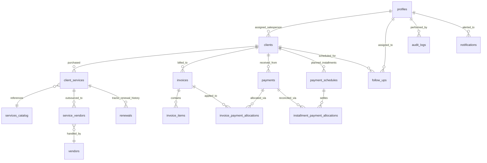

# BRAND 360s CRM — COMPLETE DATABASE SCHEMA DOCUMENTATION

This document details all 15 public tables, columns, constraints, foreign keys, triggers, Row Level Security (RLS) policies, and custom Remote Procedure Call (RPC) functions in Supabase PostgreSQL.

---

## 1. Entity-Relationship Overview

---

## 2. Table Specifications

### 2.1 `profiles`
Stores internal system users, authentication roles, and contact information linked to `auth.users`.
- **Columns:**
  - `id` (UUID, Primary Key, references `auth.users.id` ON DELETE CASCADE)
  - `email` (TEXT, NOT NULL, UNIQUE)
  - `full_name` (TEXT, NOT NULL)
  - `role` (TEXT, NOT NULL, CHECK `role IN ('admin', 'employee')`)
  - `is_active` (BOOLEAN, DEFAULT true)
  - `phone` (TEXT)
  - `created_at` (TIMESTAMPTZ, DEFAULT now())
  - `updated_at` (TIMESTAMPTZ, DEFAULT now())
- **RLS Policies:**
  - Users can read their own profile.
  - Admins can read, create, and update all profiles.
  - Employees cannot elevate their own role.

---

### 2.2 `clients`
Core entity containing business records, company identity, financial snapshots, and salesperson assignment.
- **Columns:**
  - `id` (UUID, Primary Key, DEFAULT gen_random_uuid())
  - `client_code` (TEXT, UNIQUE, NOT NULL, format: `CLI-YYYY-XXXX`)
  - `company_name` (TEXT, NOT NULL)
  - `normalized_company_name` (TEXT, generated via trigger for duplicate prevention)
  - `brand_name` (TEXT)
  - `primary_contact_person` (TEXT, NOT NULL)
  - `primary_email` (TEXT, NOT NULL)
  - `primary_phone` (TEXT, NOT NULL)
  - `secondary_phone` (TEXT)
  - `website` (TEXT)
  - `registered_address` (TEXT)
  - `city` (TEXT)
  - `state` (TEXT)
  - `postal_code` (TEXT)
  - `country` (TEXT, DEFAULT 'India')
  - `gstin` (TEXT)
  - `pan` (TEXT)
  - `salesperson_id` (UUID, references `profiles.id`)
  - `salesperson_name` (TEXT)
  - `client_status` (TEXT, DEFAULT 'Active', CHECK `client_status IN ('Active', 'Archived', 'Suspended')`)
  - `contract_value` (NUMERIC(12,2), DEFAULT 0)
  - `payments_received` (NUMERIC(12,2), DEFAULT 0)
  - `balance_receivable` (NUMERIC(12,2), DEFAULT 0)
  - `payment_status` (TEXT, DEFAULT 'Unpaid')
  - `next_payment_due_date` (DATE)
  - `next_payment_due_amount` (NUMERIC(12,2), DEFAULT 0)
  - `date_of_creation` (DATE, DEFAULT CURRENT_DATE)
  - `created_at` (TIMESTAMPTZ, DEFAULT now())
  - `updated_at` (TIMESTAMPTZ, DEFAULT now())
- **Indexes:** `idx_clients_salesperson`, `idx_clients_company_normalized`, `idx_clients_email`, `idx_clients_phone`.
- **Triggers:** `trg_normalize_client_name` automatically strips spaces and non-alphanumeric characters for case-insensitive duplicate prevention.

---

### 2.3 `services_catalog`
Master service catalog containing standard enterprise service definitions and baseline pricing.
- **Columns:**
  - `id` (UUID, Primary Key, DEFAULT gen_random_uuid())
  - `name` (TEXT, NOT NULL, UNIQUE)
  - `category` (TEXT, NOT NULL)
  - `description` (TEXT)
  - `base_price` (NUMERIC(10,2), DEFAULT 0)
  - `is_active` (BOOLEAN, DEFAULT true)
  - `created_at` (TIMESTAMPTZ, DEFAULT now())

---

### 2.4 `client_services`
Junction table tracking services purchased by specific clients, custom contract terms, delivery milestones, and renewal expiry dates.
- **Columns:**
  - `id` (UUID, Primary Key, DEFAULT gen_random_uuid())
  - `client_id` (UUID, NOT NULL, references `clients.id` ON DELETE CASCADE)
  - `service_id` (UUID, references `services_catalog.id`)
  - `service_name` (TEXT, NOT NULL)
  - `category` (TEXT)
  - `contract_value` (NUMERIC(12,2), NOT NULL, DEFAULT 0)
  - `billing_frequency` (TEXT, CHECK `billing_frequency IN ('one-time', 'monthly', 'quarterly', 'annual')`)
  - `start_date` (DATE, NOT NULL)
  - `end_date` (DATE)
  - `expiry_date` (DATE)
  - `delivery_status` (TEXT, DEFAULT 'Active', CHECK `delivery_status IN ('Pending', 'Active', 'Completed', 'Cancelled')`)
  - `notes` (TEXT)
  - `created_at` (TIMESTAMPTZ, DEFAULT now())

---

### 2.5 `renewals`
Audit and workflow ledger tracking recurring contract renewals, previous contract values, renewed terms, and renewal invoices.
- **Columns:**
  - `id` (UUID, Primary Key, DEFAULT gen_random_uuid())
  - `client_service_id` (UUID, NOT NULL, references `client_services.id` ON DELETE CASCADE)
  - `client_id` (UUID, NOT NULL, references `clients.id` ON DELETE CASCADE)
  - `previous_expiry_date` (DATE, NOT NULL)
  - `renewal_start_date` (DATE, NOT NULL)
  - `renewal_end_date` (DATE, NOT NULL)
  - `renewal_amount` (NUMERIC(12,2), NOT NULL)
  - `renewal_status` (TEXT, DEFAULT 'Pending', CHECK `renewal_status IN ('Pending', 'In Progress', 'Renewed', 'Cancelled')`)
  - `invoice_id` (UUID, references `invoices.id`)
  - `payment_status` (TEXT, DEFAULT 'Unpaid')
  - `notes` (TEXT)
  - `renewed_by` (UUID, references `profiles.id`)
  - `created_at` (TIMESTAMPTZ, DEFAULT now())

---

### 2.6 `vendors`
Third-party vendors, suppliers, freelance professionals, and outsourcing partners.
- **Columns:**
  - `id` (UUID, Primary Key, DEFAULT gen_random_uuid())
  - `name` (TEXT, NOT NULL)
  - `category` (TEXT, NOT NULL)
  - `contact_person` (TEXT)
  - `email` (TEXT)
  - `phone` (TEXT)
  - `gstin` (TEXT)
  - `status` (TEXT, DEFAULT 'Active', CHECK `status IN ('Active', 'Inactive')`)
  - `notes` (TEXT)
  - `created_at` (TIMESTAMPTZ, DEFAULT now())

---

### 2.7 `service_vendors`
Outsourcing relationship table linking vendors to specific client deliverables.
- **Columns:**
  - `id` (UUID, Primary Key, DEFAULT gen_random_uuid())
  - `client_service_id` (UUID, NOT NULL, references `client_services.id` ON DELETE CASCADE)
  - `vendor_id` (UUID, NOT NULL, references `vendors.id` ON DELETE CASCADE)
  - `agreed_cost` (NUMERIC(12,2), NOT NULL, DEFAULT 0)
  - `scope_description` (TEXT)
  - `delivery_deadline` (DATE)
  - `status` (TEXT, DEFAULT 'Assigned', CHECK `status IN ('Assigned', 'In Progress', 'Completed', 'Cancelled')`)
  - `created_at` (TIMESTAMPTZ, DEFAULT now())

---

### 2.8 `invoices`
Commercial tax invoice ledger.
- **Columns:**
  - `id` (UUID, Primary Key, DEFAULT gen_random_uuid())
  - `invoice_number` (TEXT, NOT NULL, UNIQUE)
  - `client_id` (UUID, NOT NULL, references `clients.id` ON DELETE RESTRICT)
  - `issue_date` (DATE, NOT NULL, DEFAULT CURRENT_DATE)
  - `due_date` (DATE, NOT NULL)
  - `subtotal` (NUMERIC(12,2), NOT NULL, DEFAULT 0)
  - `tax_amount` (NUMERIC(12,2), NOT NULL, DEFAULT 0)
  - `total_amount` (NUMERIC(12,2), NOT NULL, DEFAULT 0)
  - `paid_amount` (NUMERIC(12,2), NOT NULL, DEFAULT 0)
  - `balance_amount` (NUMERIC(12,2), NOT NULL, DEFAULT 0)
  - `status` (TEXT, DEFAULT 'Unpaid', CHECK `status IN ('Unpaid', 'Partially Paid', 'Paid', 'Cancelled')`)
  - `notes` (TEXT)
  - `created_by` (UUID, references `profiles.id`)
  - `created_at` (TIMESTAMPTZ, DEFAULT now())

---

### 2.9 `invoice_items`
Line items for issued invoices.
- **Columns:**
  - `id` (UUID, Primary Key, DEFAULT gen_random_uuid())
  - `invoice_id` (UUID, NOT NULL, references `invoices.id` ON DELETE CASCADE)
  - `description` (TEXT, NOT NULL)
  - `quantity` (NUMERIC(8,2), NOT NULL, DEFAULT 1)
  - `unit_price` (NUMERIC(12,2), NOT NULL, DEFAULT 0)
  - `gst_rate` (NUMERIC(5,2), NOT NULL, DEFAULT 18.0)
  - `amount` (NUMERIC(12,2), NOT NULL, DEFAULT 0)

---

### 2.10 `payments`
Master transaction table recording incoming funds from clients.
- **Columns:**
  - `id` (UUID, Primary Key, DEFAULT gen_random_uuid())
  - `client_id` (UUID, NOT NULL, references `clients.id` ON DELETE RESTRICT)
  - `amount` (NUMERIC(12,2), NOT NULL)
  - `payment_date` (DATE, NOT NULL, DEFAULT CURRENT_DATE)
  - `payment_method` (TEXT, NOT NULL)
  - `reference_number` (TEXT)
  - `notes` (TEXT)
  - `allocated_amount` (NUMERIC(12,2), DEFAULT 0)
  - `allocation_status` (TEXT, DEFAULT 'Unallocated', CHECK `allocation_status IN ('Unallocated', 'Partially Allocated', 'Fully Allocated')`)
  - `status` (TEXT, DEFAULT 'Completed', CHECK `status IN ('Pending', 'Completed', 'Failed')`)
  - `recorded_by` (UUID, references `profiles.id`)
  - `created_at` (TIMESTAMPTZ, DEFAULT now())

---

### 2.11 `invoice_payment_allocations`
Junction table tracking how payments are distributed across invoices.
- **Columns:**
  - `id` (UUID, Primary Key, DEFAULT gen_random_uuid())
  - `payment_id` (UUID, NOT NULL, references `payments.id` ON DELETE CASCADE)
  - `invoice_id` (UUID, NOT NULL, references `invoices.id` ON DELETE RESTRICT)
  - `allocated_amount` (NUMERIC(12,2), NOT NULL)
  - `allocated_at` (TIMESTAMPTZ, DEFAULT now())
  - `allocated_by` (UUID, references `profiles.id`)

---

### 2.12 `payment_schedules`
Milestone-based payment schedules planned for a client.
- **Columns:**
  - `id` (UUID, Primary Key, DEFAULT gen_random_uuid())
  - `client_id` (UUID, NOT NULL, references `clients.id` ON DELETE CASCADE)
  - `invoice_id` (UUID, references `invoices.id` ON DELETE SET NULL)
  - `milestone_name` (TEXT, NOT NULL)
  - `expected_amount` (NUMERIC(12,2), NOT NULL)
  - `received_amount` (NUMERIC(12,2), DEFAULT 0)
  - `outstanding_balance` (NUMERIC(12,2), NOT NULL)
  - `due_date` (DATE, NOT NULL)
  - `status` (TEXT, DEFAULT 'Pending', CHECK `status IN ('Pending', 'Partially Paid', 'Paid', 'Overdue', 'Cancelled')`)
  - `created_at` (TIMESTAMPTZ, DEFAULT now())

---

### 2.13 `installment_payment_allocations`
Junction table tracking allocations between recorded payments and installment milestones.
- **Columns:**
  - `id` (UUID, Primary Key, DEFAULT gen_random_uuid())
  - `payment_id` (UUID, NOT NULL, references `payments.id` ON DELETE CASCADE)
  - `installment_id` (UUID, NOT NULL, references `payment_schedules.id` ON DELETE CASCADE)
  - `allocated_amount` (NUMERIC(12,2), NOT NULL)
  - `allocated_at` (TIMESTAMPTZ, DEFAULT now())

---

### 2.14 `follow_ups`
Task and interaction tracker.
- **Columns:**
  - `id` (UUID, Primary Key, DEFAULT gen_random_uuid())
  - `client_id` (UUID, NOT NULL, references `clients.id` ON DELETE CASCADE)
  - `assigned_to` (UUID, references `profiles.id`)
  - `title` (TEXT, NOT NULL)
  - `type` (TEXT, NOT NULL, CHECK `type IN ('Call', 'Email', 'Meeting', 'Payment Reminder', 'Renewal', 'Other')`)
  - `priority` (TEXT, DEFAULT 'Medium', CHECK `priority IN ('Low', 'Medium', 'High', 'Urgent')`)
  - `status` (TEXT, DEFAULT 'Pending', CHECK `status IN ('Pending', 'In Progress', 'Completed', 'Cancelled')`)
  - `due_date` (TIMESTAMPTZ, NOT NULL)
  - `completed_at` (TIMESTAMPTZ)
  - `notes` (TEXT)
  - `created_at` (TIMESTAMPTZ, DEFAULT now())

---

### 2.15 `notifications`
Notification store for automated system alerts and user tasks.
- **Columns:**
  - `id` (UUID, Primary Key, DEFAULT gen_random_uuid())
  - `user_id` (UUID, references `profiles.id` ON DELETE CASCADE)
  - `title` (TEXT, NOT NULL)
  - `description` (TEXT, NOT NULL)
  - `category` (TEXT, DEFAULT 'Alert', CHECK `category IN ('Alert', 'Update')`)
  - `type` (TEXT, NOT NULL)
  - `link_url` (TEXT)
  - `is_read` (BOOLEAN, DEFAULT false)
  - `created_at` (TIMESTAMPTZ, DEFAULT now())

---

## 3. Remote Procedure Call (RPC) Functions

### 3.1 `allocate_payment_to_invoice`
- **Signature:** `allocate_payment_to_invoice(p_payment_id UUID, p_invoice_id UUID, p_amount NUMERIC, p_user_id UUID)`
- **Behavior:**
  1. Validates that `payment.client_id === invoice.client_id`.
  2. Ensures payment unallocated amount `>= p_amount`.
  3. Ensures invoice outstanding balance `>= p_amount`.
  4. Inserts row into `invoice_payment_allocations`.
  5. Increments `invoice.paid_amount` by `p_amount` and decrements `invoice.balance_amount`.
  6. Updates `invoice.status` (`Paid` if balance is 0, else `Partially Paid`).
  7. Increments `payment.allocated_amount`.
  8. Recalculates `payment.allocation_status` (`Fully Allocated` or `Partially Allocated`).
  9. Recalculates client balance in `clients` table.

### 3.2 `reconcile_and_allocate_payment`
- **Signature:** `reconcile_and_allocate_payment(p_payment_id UUID, p_installment_id UUID, p_amount NUMERIC)`
- **Behavior:**
  1. Validates installment existence and unallocated payment funds.
  2. Links payment to milestone in `installment_payment_allocations`.
  3. Updates milestone `received_amount` and `outstanding_balance`.
  4. Sets milestone status to `Paid` if outstanding balance reaches zero.

