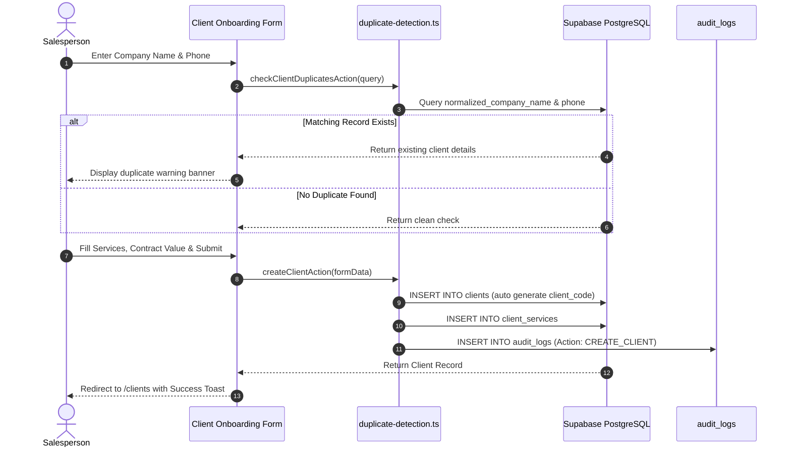
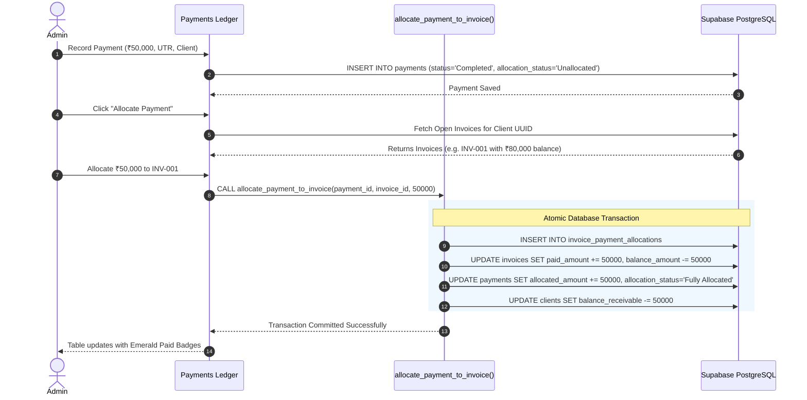
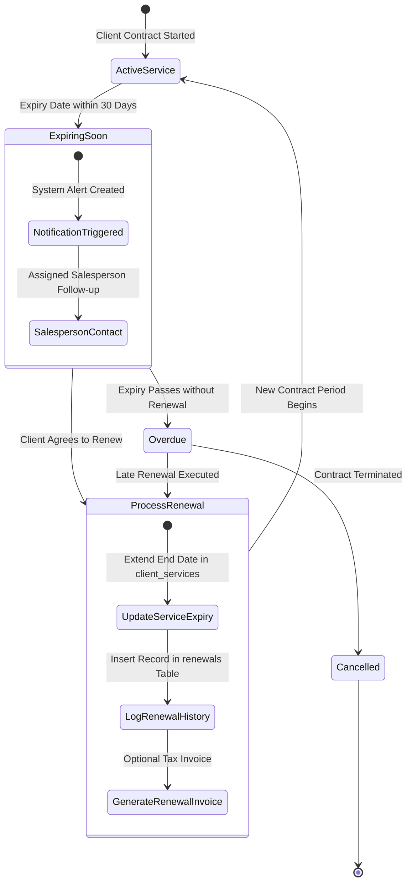
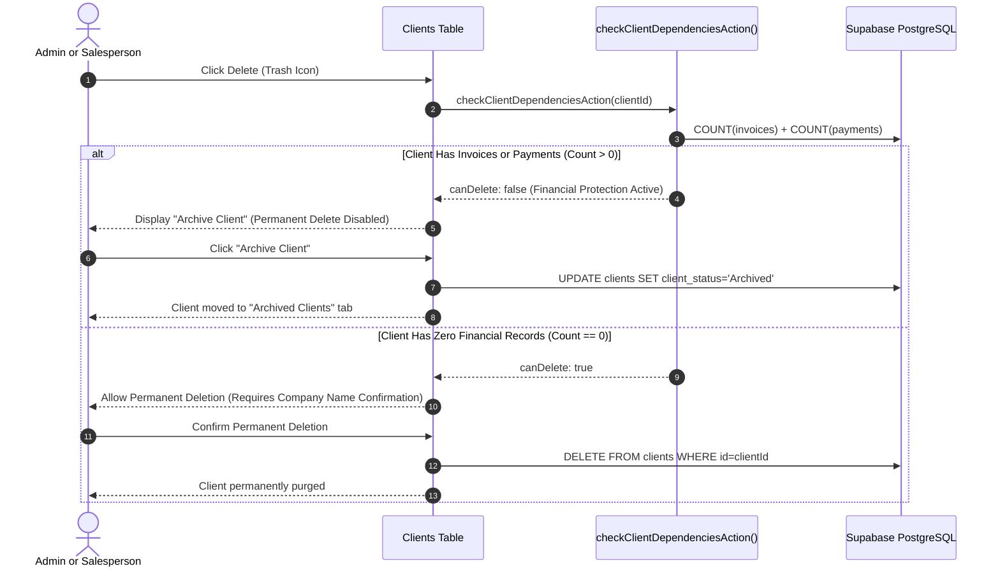

# BRAND 360s CRM — WORKFLOW DIAGRAMS

This document illustrates the primary operational workflows of BRAND 360s CRM using Mermaid sequence and state diagrams.

---

## 1. Client Onboarding & Duplicate Prevention Workflow

---

## 2. Payment Collection & Invoice Allocation Workflow

---

## 3. Service Renewal Management Workflow

---

## 4. Client Financial Protection & Archival Workflow

