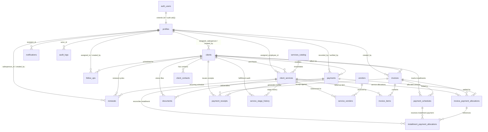

# Brand360s CRM — Complete Database Schema & Architecture Report

> **System Implementation:** Supabase PostgreSQL Database  
> **Target System:** Brand360s Business & Client Lifecycle Management CRM  
> **Source Evidence:** Verified against SQL Migrations (`002` through `037`), Base Schemas (`supabase_complete_schema.sql`, `supabase_auth_profiles.sql`, `supabase_schema.sql`), and Project Source Actions/Components.  
> **Generated Date:** November 2026  

---

## Table of Contents
1. [Executive Summary & Database Architecture](#1-executive-summary--database-architecture)
2. [Entity-Relationship Diagram (ERD)](#2-entity-relationship-diagram-erd)
3. [Complete Database Tables & Schema Specifications](#3-complete-database-tables--schema-specifications)
   - 3.1 [`profiles`](#31-profiles)
   - 3.2 [`clients`](#32-clients)
   - 3.3 [`client_contacts`](#33-client_contacts)
   - 3.4 [`services_catalog`](#34-services_catalog)
   - 3.5 [`client_services`](#35-client_services)
   - 3.6 [`service_stage_history`](#36-service_stage_history)
   - 3.7 [`invoices`](#37-invoices)
   - 3.8 [`invoice_items`](#38-invoice_items)
   - 3.9 [`invoice_counters`](#39-invoice_counters)
   - 3.10 [`payments`](#310-payments)
   - 3.11 [`payment_schedules`](#311-payment_schedules)
   - 3.12 [`invoice_payment_allocations`](#312-invoice_payment_allocations)
   - 3.13 [`installment_payment_allocations`](#313-installment_payment_allocations)
   - 3.14 [`payment_receipts`](#314-payment_receipts)
   - 3.15 [`follow_ups`](#315-follow_ups)
   - 3.16 [`renewals`](#316-renewals)
   - 3.17 [`documents`](#317-documents)
   - 3.18 [`vendors`](#318-vendors)
   - 3.19 [`service_vendors`](#319-service_vendors)
   - 3.20 [`notifications`](#320-notifications)
   - 3.21 [`audit_logs`](#321-audit_logs)
   - 3.22 [`crm_settings`](#322-crm_settings)
   - 3.23 [`sales_incentives`](#323-sales_incentives)
4. [Frontend Input Fields to Database Columns Mapping](#4-frontend-input-fields-to-database-columns-mapping)
5. [Database Triggers, Functions & Stored Procedures (RPCs)](#5-database-triggers-functions--stored-procedures-rpcs)
6. [Row Level Security (RLS) Policies](#6-row-level-security-rls-policies)
7. [Table Interconnections & Business Lifecycles](#7-table-interconnections--business-lifecycles)

---

## 1. Executive Summary & Database Architecture

The **Brand360s CRM** database is built on **Supabase (PostgreSQL 15+)**. It implements a normalized, relational multi-tenant architecture with strict **Row Level Security (RLS)**, automated financial synchronization triggers, atomic stored procedures (RPCs), and compliance safeguards for statutory business operations.

### Key Architecture Tenets:
1. **Unified Identity & Role-Based Access Control (RBAC):**  
   The database leverages `auth.users` from Supabase Auth and binds it to `public.profiles`. Two operational roles are recognized: `'admin'` (full access) and `'employee'` (isolated to assigned clients, assigned services, and designated tasks).
2. **Financial Single Source of Truth:**  
   The client's commercial figures (`contract_value`, `payments_received`, `balance_receivable`) are calculated directly from active line-item services (`client_services`) and verified payment transactions (`payments`). Triggers (`trg_sync_client_contract_value`, `trg_sync_financials_on_payment`) ensure real-time consistency.
3. **Atomic Payment Allocation & Double-Entry Invoicing:**  
   Payments can be recorded as unallocated credits, allocated against official tax invoices (`invoice_payment_allocations`), or reconciled across milestone schedules (`installment_payment_allocations`).
4. **Permanent Audit Trails & Statutory Compliance:**  
   Statutory records (issued tax invoices, verified payments, official receipt numbers) cannot be silently deleted. Safe-deletion routines (`safe_delete_or_archive_client`, `safe_delete_client_service`) guard against historical tax data loss.

---

## 2. Entity-Relationship Diagram (ERD)



---

## 3. Complete Database Tables & Schema Specifications

### 3.1 `profiles`
* **Purpose:** Stores employee and administrator user metadata linked 1:1 to Supabase's `auth.users` table. Houses system roles (`admin`, `employee`), profile contact info, and activity status.
* **Primary Key:** `id` (UUID) references `auth.users(id)` ON DELETE CASCADE.
* **Foreign Keys:** None (referenced by almost all other operational tables).
* **Indexes:** `idx_profiles_role` ON `(role)`, `idx_profiles_email` ON `(email)`.

| Column Name | Data Type | Nullable | Default Value | Constraints / Checks | Description |
| :--- | :--- | :--- | :--- | :--- | :--- |
| `id` | `UUID` | No | — | `PRIMARY KEY`, `REFERENCES auth.users(id)` | Supabase auth user identifier |
| `email` | `TEXT` | No | — | `UNIQUE` | User login email address |
| `full_name` | `TEXT` | No | — | — | Full display name of the employee |
| `role` | `TEXT` | No | `'employee'` | `CHECK (role IN ('admin', 'employee'))` | System access role |
| `is_active` | `BOOLEAN`| No | `true` | — | User account active toggle |
| `phone` | `TEXT` | Yes | `NULL` | — | Contact telephone number |
| `avatar_url` | `TEXT` | Yes | `NULL` | — | Profile picture image URL |
| `created_at` | `TIMESTAMPTZ`| No | `TIMEZONE('utc', NOW())` | — | Account creation timestamp |
| `updated_at` | `TIMESTAMPTZ`| No | `TIMEZONE('utc', NOW())` | — | Last update timestamp |

#### Realistic Sample Row
```json
{
  "id": "e2a4b880-9df1-49b0-953e-52ebfe815254",
  "email": "saravanan@brand360s.com",
  "full_name": "Saravanan Ramanathan",
  "role": "admin",
  "is_active": true,
  "phone": "+91 9876543210",
  "avatar_url": "https://res.cloudinary.com/brand360s/image/upload/v1/avatars/user1.jpg",
  "created_at": "2026-01-10T09:30:00Z",
  "updated_at": "2026-11-20T14:15:00Z"
}
```

---

### 3.2 `clients`
* **Purpose:** Core table for all business clients, including legal company details, trade names, billing addresses, tax registrations (GSTIN/PAN), client ownership, and auto-synchronized contract totals.
* **Primary Key:** `id` (UUID, default `gen_random_uuid()`).
* **Foreign Keys:**
  - `assigned_salesperson` → `public.profiles(id)` ON DELETE SET NULL
  - `created_by` → `public.profiles(id)` ON DELETE SET NULL
  - `archived_by` → `public.profiles(id)` ON DELETE SET NULL
* **Indexes:**
  - `idx_clients_salesperson` ON `(assigned_salesperson)`
  - `idx_clients_company_name` ON `(company_name)`
  - `idx_clients_status` ON `(client_status)`
  - `idx_clients_payment_status` ON `(payment_status)`
  - `idx_clients_created_at` ON `(created_at DESC)`
  - `idx_clients_status_created` ON `(client_status, created_at DESC)`
  - `idx_clients_trade_name` ON `(trade_name)`
  - `idx_clients_phone` ON `(phone)`
  - `idx_clients_contact_person` ON `(contact_person)`
  - `idx_clients_lower_email` ON `(LOWER(TRIM(email)))`
  - `idx_clients_normalized_company` ON `(public.normalize_client_company_name(company_name))`
  - Partial Unique: `uq_clients_active_email` ON `(LOWER(TRIM(email))) WHERE client_status != 'Archived' AND email IS NOT NULL AND TRIM(email) != ''`

| Column Name | Data Type | Nullable | Default Value | Constraints / Checks | Description |
| :--- | :--- | :--- | :--- | :--- | :--- |
| `id` | `UUID` | No | `gen_random_uuid()` | `PRIMARY KEY` | Unique client identifier |
| `client_code` | `TEXT` | No | Auto-generated | `UNIQUE` (e.g. `B360-1001`) | Sequential human-readable client code |
| `company_name` | `TEXT` | No | — | — | Registered legal name of company |
| `trade_name` | `TEXT` | Yes | `NULL` | — | Brand name / Operating trade name |
| `company_type` | `TEXT` | Yes | `'Private Limited (Pvt Ltd)'` | — | Legal constitution (Pvt Ltd, LLP, etc.) |
| `contact_person` | `TEXT` | No | — | — | Primary point of contact |
| `designation` | `TEXT` | Yes | `NULL` | — | Designation/title of primary contact |
| `email` | `TEXT` | Yes | `NULL` | — | Primary email (validated format) |
| `phone` | `TEXT` | No | — | — | Primary phone number (with country code) |
| `alternate_phone`| `TEXT` | Yes | `NULL` | — | Secondary phone / mobile |
| `website` | `TEXT` | Yes | `NULL` | — | Official business website URL |
| `address` | `TEXT` | Yes | `NULL` | — | Registered postal address |
| `city` | `TEXT` | Yes | `NULL` | — | City / Town |
| `state` | `TEXT` | Yes | `NULL` | — | State / Province |
| `pincode` | `TEXT` | Yes | `NULL` | — | Postal PIN code (6 digits) |
| `country` | `TEXT` | Yes | `'India'` | — | Country of registration |
| `gst_number` | `TEXT` | Yes | `NULL` | — | 15-character GSTIN or exempt note |
| `pan_number` | `TEXT` | Yes | `NULL` | — | 10-character Permanent Account Number |
| `is_not_gst_registered` | `BOOLEAN` | Yes | `false` | — | True if exempt from GST registration |
| `additional_contacts` | `JSONB` | Yes | `'[]'::jsonb` | — | JSON list of additional contacts |
| `billing_name` | `TEXT` | Yes | `NULL` | — | Billing legal entity name |
| `billing_address`| `TEXT` | Yes | `NULL` | — | Invoicing postal address |
| `billing_contact`| `TEXT` | Yes | `NULL` | — | Billing contact person |
| `billing_email` | `TEXT` | Yes | `NULL` | — | Finance / Accounts email |
| `client_since` | `DATE` | Yes | `CURRENT_DATE` | — | Relationship start date |
| `assigned_salesperson` | `UUID` | Yes | `NULL` | `REFERENCES profiles(id)` | Sales owner / Account manager |
| `client_status` | `TEXT` | No | `'Active'` | `CHECK (client_status IN ('Active', 'Inactive', 'Pending Onboarding', 'On Hold', 'Completed', 'Archived'))` | Client account lifecycle status |
| `services_purchased` | `TEXT` | Yes | `'Company Registration'` | — | Text summary list of services purchased |
| `contract_value`| `NUMERIC(12,2)` | No | `0.00` | Auto-synced from `client_services` | Total agreed commercial value (excl. tax) |
| `payments_received` | `NUMERIC(12,2)` | No | `0.00` | Auto-synced from `payments` | Total verified payments collected |
| `balance_receivable` | `NUMERIC(12,2)`| No | `0.00` | Auto-synced | Remaining balance to collect |
| `next_payment_due_amount` | `NUMERIC(12,2)`| Yes | `0.00` | — | Amount due in next installment milestone |
| `next_payment_due_date` | `DATE` | Yes | `NULL` | — | Target due date of next installment |
| `payment_status`| `TEXT` | No | `'Upcoming'` | `CHECK (payment_status IN ('Paid in full', 'Overdue', 'Upcoming', 'Partially Paid'))` | Client-level collection health |
| `notes` | `TEXT` | Yes | `NULL` | — | Internal relationship notes |
| `archived_at` | `TIMESTAMPTZ`| Yes | `NULL` | — | Timestamp when client was archived |
| `archived_by` | `UUID` | Yes | `NULL` | `REFERENCES profiles(id)` | User who archived the client |
| `archive_reason`| `TEXT` | Yes | `NULL` | — | Justification for archiving |
| `created_by` | `UUID` | Yes | `NULL` | `REFERENCES profiles(id)` | User who initially created the client |
| `created_at` | `TIMESTAMPTZ`| No | `TIMEZONE('utc', NOW())` | — | Client creation timestamp |
| `updated_at` | `TIMESTAMPTZ`| No | `TIMEZONE('utc', NOW())` | Auto-updated | Last record update timestamp |

#### Realistic Sample Row
```json
{
  "id": "c1f7b029-43d8-4f51-b0db-6e696f8c8552",
  "client_code": "B360-1021",
  "company_name": "Dreamm Holidayz Pvt Ltd",
  "trade_name": "Dreamm Holidayz",
  "company_type": "Private Limited (Pvt Ltd)",
  "contact_person": "Venkatesh Kumar",
  "designation": "Managing Director",
  "email": "venkatesh@dreammholidayz.com",
  "phone": "+91 9443210987",
  "alternate_phone": "+91 9443210988",
  "website": "https://dreammholidayz.com",
  "address": "No. 42, West Coast Road, Sivaganga",
  "city": "Sivaganga",
  "state": "Tamil Nadu",
  "pincode": "630561",
  "country": "India",
  "gst_number": "33AABCD1234E1Z7",
  "pan_number": "AABCD1234E",
  "is_not_gst_registered": false,
  "additional_contacts": [
    {
      "name": "Kavitha V",
      "designation": "Director - Finance",
      "phone": "+91 9884012345",
      "email": "accounts@dreammholidayz.com"
    }
  ],
  "billing_name": "Dreamm Holidayz Private Limited",
  "billing_address": "No. 42, West Coast Road, Sivaganga 630561",
  "billing_contact": "Kavitha V",
  "billing_email": "accounts@dreammholidayz.com",
  "client_since": "2026-11-20",
  "assigned_salesperson": "e2a4b880-9df1-49b0-953e-52ebfe815254",
  "client_status": "Active",
  "services_purchased": "Website Development, Social Media Marketing",
  "contract_value": 67000.00,
  "payments_received": 0.00,
  "balance_receivable": 67000.00,
  "next_payment_due_amount": 45000.00,
  "next_payment_due_date": "2026-12-04",
  "payment_status": "Upcoming",
  "notes": "High priority website launch before Q1 peak vacation season.",
  "archived_at": null,
  "archived_by": null,
  "archive_reason": null,
  "created_by": "e2a4b880-9df1-49b0-953e-52ebfe815254",
  "created_at": "2026-11-20T10:00:00Z",
  "updated_at": "2026-11-20T11:30:00Z"
}
```

---

### 3.3 `client_contacts`
* **Purpose:** Stores secondary and stakeholder contacts associated with a client company (used for multi-director corporate accounts).
* **Primary Key:** `id` (UUID, default `gen_random_uuid()`).
* **Foreign Keys:** `client_id` → `public.clients(id)` ON DELETE CASCADE.
* **Indexes:** `idx_contacts_client` ON `(client_id)`.

| Column Name | Data Type | Nullable | Default Value | Constraints / Checks | Description |
| :--- | :--- | :--- | :--- | :--- | :--- |
| `id` | `UUID` | No | `gen_random_uuid()` | `PRIMARY KEY` | Contact ID |
| `client_id` | `UUID` | No | — | `REFERENCES clients(id)` | Associated client |
| `contact_person`| `TEXT` | No | — | — | Name of contact |
| `designation` | `TEXT` | Yes | `NULL` | — | Designation / Role |
| `phone` | `TEXT` | No | — | — | Phone number |
| `whatsapp` | `TEXT` | Yes | `NULL` | — | WhatsApp number |
| `email` | `TEXT` | No | — | — | Email address |
| `is_primary` | `BOOLEAN`| Yes | `true` | — | Whether designated as primary |
| `billing_contact`| `TEXT` | Yes | `NULL` | — | Billing person name |
| `billing_email` | `TEXT` | Yes | `NULL` | — | Billing specific email |
| `created_at` | `TIMESTAMPTZ`| No | `TIMEZONE('utc', NOW())` | — | Creation timestamp |

#### Realistic Sample Row
```json
{
  "id": "9d1b033e-e67c-40ea-9442-f81d1ba86ff4",
  "client_id": "c1f7b029-43d8-4f51-b0db-6e696f8c8552",
  "contact_person": "Kavitha V",
  "designation": "Director - Finance",
  "phone": "+91 9884012345",
  "whatsapp": "+91 9884012345",
  "email": "accounts@dreammholidayz.com",
  "is_primary": false,
  "billing_contact": "Kavitha V",
  "billing_email": "accounts@dreammholidayz.com",
  "created_at": "2026-11-20T10:05:00Z"
}
```

---

### 3.4 `services_catalog`
* **Purpose:** Master repository of standard business solutions provided by Brand360s (Incorporations, Tax, Trademark, Branding, Web, SEO). Pre-populates default fees and fulfillment workflow presets.
* **Primary Key:** `id` (UUID, default `gen_random_uuid()`).
* **Foreign Keys:** None.
* **Indexes:** Unique index on `name`.

| Column Name | Data Type | Nullable | Default Value | Constraints / Checks | Description |
| :--- | :--- | :--- | :--- | :--- | :--- |
| `id` | `UUID` | No | `gen_random_uuid()` | `PRIMARY KEY` | Service catalog item ID |
| `name` | `TEXT` | No | — | `UNIQUE` | Distinct service name |
| `category` | `TEXT` | No | — | — | Business category group |
| `description` | `TEXT` | Yes | `NULL` | — | Service description |
| `default_service_fee` | `NUMERIC(12,2)` | Yes | `0.00` | — | Base professional consulting fee |
| `default_govt_fee` | `NUMERIC(12,2)` | Yes | `0.00` | — | Statutory / Government filing fee |
| `workflow_preset` | `TEXT` | Yes | `NULL` | — | Preset key: `'website'`, `'gst'`, `'trademark'`, `'incorporation'`, `'compliance'`, `'general'` |
| `is_active` | `BOOLEAN` | Yes | `true` | — | Active in catalog |
| `created_at` | `TIMESTAMPTZ`| No | `TIMEZONE('utc', NOW())` | — | Creation timestamp |

#### Realistic Sample Row
```json
{
  "id": "3a70b0cd-5421-4d33-a3d2-4e4cf1f1a512",
  "name": "Website Development",
  "category": "Branding & Web Development",
  "description": "Full-stack corporate responsive website with UI/UX design and CMS integration.",
  "default_service_fee": 45000.00,
  "default_govt_fee": 0.00,
  "workflow_preset": "website",
  "is_active": true,
  "created_at": "2026-11-11T12:00:00Z"
}
```

---

### 3.5 `client_services`
* **Purpose:** Represents a concrete service contracted by a client. Tracks commercial charges, government fees, tax rates, fulfillment stages, stage progression percentage, assigned employee, delivery targets, and renewal status.
* **Primary Key:** `id` (UUID, default `gen_random_uuid()`).
* **Foreign Keys:**
  - `client_id` → `public.clients(id)` ON DELETE CASCADE
  - `assigned_employee_id` → `public.profiles(id)` ON DELETE SET NULL
* **Indexes:**
  - `idx_client_services_client` ON `(client_id)`
  - `idx_client_services_assigned` ON `(assigned_employee_id)`
  - `idx_client_services_status` ON `(service_status)`
  - `idx_client_services_client_status` ON `(client_id, service_status)`
  - `idx_client_services_renewal_date` ON `(renewal_date)`
  - `idx_client_services_renewal_status` ON `(renewal_status)`

| Column Name | Data Type | Nullable | Default Value | Constraints / Checks | Description |
| :--- | :--- | :--- | :--- | :--- | :--- |
| `id` | `UUID` | No | `gen_random_uuid()` | `PRIMARY KEY` | Client service identifier |
| `client_id` | `UUID` | No | — | `REFERENCES clients(id)` | Contracted client |
| `service_name` | `TEXT` | No | — | — | Name of service |
| `service_category` | `TEXT` | Yes | `NULL` | — | Category grouping |
| `service_status` | `TEXT` | No | `'Processing'` | `CHECK (service_status IN ('Pending', 'In Progress', 'New', 'Documents Pending', 'Processing', 'Waiting for Approval', 'Completed', 'On Hold', 'Cancelled'))` | Operational stage |
| `assigned_employee_id`| `UUID` | Yes | `NULL` | `REFERENCES profiles(id)` | Assigned operational specialist |
| `service_fee` | `NUMERIC(12,2)` | No | `0.00` | — | Brand360s professional fee |
| `govt_fee` | `NUMERIC(12,2)` | No | `0.00` | — | Statutory government charges |
| `additional_fee` | `NUMERIC(12,2)` | No | `0.00` | — | Supplementary / Out-of-pocket charges |
| `discount` | `NUMERIC(12,2)` | No | `0.00` | — | Applied discount |
| `tax_amount` | `NUMERIC(12,2)` | No | `0.00` | — | Calculated GST tax amount |
| `total_amount` | `NUMERIC(12,2)` | No | `0.00` | `service_fee + govt_fee + additional_fee - discount` | Contract total value for this service |
| `tax_rate` | `NUMERIC(5,2)` | Yes | `18.00` | Safe default `0.00` on older schemas | Applied GST percentage |
| `workflow_preset` | `TEXT` | Yes | `NULL` | — | Active workflow template key |
| `fulfillment_stages` | `JSONB` | Yes | `NULL` | e.g. `[{"name":"Requirements","status":"completed"}]` | Array of milestone stages with states |
| `current_stage_name` | `TEXT` | Yes | `NULL` | — | Label of active stage |
| `current_stage_description`| `TEXT` | Yes | `NULL` | — | Brief note on current stage action |
| `progress_percentage` | `INTEGER` | Yes | `0` | `0` to `100` | Fulfillment completion % |
| `start_date` | `DATE` | Yes | `NULL` | — | Project kickoff date |
| `expected_completion_date`| `DATE` | Yes | `NULL` | Working days enforced | Target deliverable completion date |
| `actual_completion_date` | `DATE` | Yes | `NULL` | — | Date marked completed |
| `renewal_date` | `DATE` | Yes | `NULL` | — | Next statutory/service renewal date |
| `renewal_amount` | `NUMERIC(12,2)`| Yes | `0.00` | — | Projected renewal price |
| `renewal_status` | `TEXT` | Yes | `'Upcoming'` | `CHECK (renewal_status IN ('Upcoming', 'Due Soon', 'Overdue', 'Renewed', 'Expired'))` | Renewal state |
| `last_renewed_at` | `TIMESTAMPTZ`| Yes | `NULL` | — | Timestamp of last completed renewal |
| `notes` | `TEXT` | Yes | `NULL` | — | Operational fulfillment notes |
| `created_at` | `TIMESTAMPTZ`| No | `TIMEZONE('utc', NOW())` | — | Record creation timestamp |
| `updated_at` | `TIMESTAMPTZ`| No | `TIMEZONE('utc', NOW())` | Auto-updated | Last updated timestamp |

#### Realistic Sample Row
```json
{
  "id": "5001c561-c58e-405b-bd94-d6754ccb6ed8",
  "client_id": "c1f7b029-43d8-4f51-b0db-6e696f8c8552",
  "service_name": "Website Development",
  "service_category": "Branding & Web Development",
  "service_status": "Pending",
  "assigned_employee_id": "e2a4b880-9df1-49b0-953e-52ebfe815254",
  "service_fee": 45000.00,
  "govt_fee": 0.00,
  "additional_fee": 0.00,
  "discount": 0.00,
  "tax_amount": 8100.00,
  "total_amount": 45000.00,
  "tax_rate": 18.00,
  "workflow_preset": "website",
  "fulfillment_stages": [
    { "name": "Requirements", "status": "completed" },
    { "name": "UI/UX Design", "status": "completed" },
    { "name": "Development", "status": "completed" },
    { "name": "Client Review", "status": "upcoming" },
    { "name": "Deployment", "status": "upcoming" }
  ],
  "current_stage_name": "Development",
  "current_stage_description": "Frontend and backend integration in progress",
  "progress_percentage": 40,
  "start_date": "2026-11-20",
  "expected_completion_date": "2026-12-04",
  "actual_completion_date": null,
  "renewal_date": "2027-11-20",
  "renewal_amount": 10000.00,
  "renewal_status": "Upcoming",
  "last_renewed_at": null,
  "notes": "Custom travel booking integration requested.",
  "created_at": "2026-11-20T10:10:00Z",
  "updated_at": "2026-11-21T06:30:00Z"
}
```

---

### 3.6 `service_stage_history`
* **Purpose:** Audit ledger for fulfillment progress. Whenever an employee or admin advances, reverts, or notes a stage in `client_services`, an immutable row is appended here.
* **Primary Key:** `id` (UUID, default `gen_random_uuid()`).
* **Foreign Keys:**
  - `client_id` → `public.clients(id)` ON DELETE CASCADE
  - `client_service_id` → `public.client_services(id)` ON DELETE CASCADE
  - `updated_by` → `public.profiles(id)` ON DELETE SET NULL
* **Indexes:** `idx_stage_history_client_id`, `idx_stage_history_service_id`, `idx_stage_history_created_at`.

| Column Name | Data Type | Nullable | Default Value | Constraints / Checks | Description |
| :--- | :--- | :--- | :--- | :--- | :--- |
| `id` | `UUID` | No | `gen_random_uuid()` | `PRIMARY KEY` | Log entry ID |
| `client_id` | `UUID` | No | — | `REFERENCES clients(id)` | Client ID |
| `client_service_id` | `UUID` | No | — | `REFERENCES client_services(id)` | Service ID |
| `previous_stage` | `TEXT` | Yes | `NULL` | — | Stage name prior to step |
| `new_stage` | `TEXT` | No | — | — | Stage name advanced to |
| `action_type` | `TEXT` | No | `'ADVANCE'` | `'ADVANCE'`, `'REVERT'`, `'NOTE'`, `'COMPLETE'` | Progression trigger |
| `notes` | `TEXT` | Yes | `NULL` | — | Comments recorded by employee |
| `progress_percentage`| `INTEGER` | Yes | `NULL` | — | Progress % at time of event |
| `updated_by` | `UUID` | Yes | `NULL` | `REFERENCES profiles(id)` | Employee who logged transition |
| `created_at` | `TIMESTAMPTZ`| No | `NOW()` | — | Transition timestamp |

#### Realistic Sample Row
```json
{
  "id": "78de31ca-3d44-411a-b61a-038b417eef98",
  "client_id": "c1f7b029-43d8-4f51-b0db-6e696f8c8552",
  "client_service_id": "5001c561-c58e-405b-bd94-d6754ccb6ed8",
  "previous_stage": "UI/UX Design",
  "new_stage": "Development",
  "action_type": "ADVANCE",
  "notes": "Wireframes approved by Venkatesh Kumar. Started Next.js implementation.",
  "progress_percentage": 40,
  "updated_by": "e2a4b880-9df1-49b0-953e-52ebfe815254",
  "created_at": "2026-11-20T14:30:00Z"
}
```

---

### 3.7 `invoices`
* **Purpose:** Official tax invoices generated for clients. Manages calendar-year sequential numbering (`B360-INV-YYYY-NNNN`), tax breakdowns (CGST, SGST, IGST), payment terms, amount paid, and collection balance.
* **Primary Key:** `id` (UUID, default `gen_random_uuid()`).
* **Foreign Keys:**
  - `client_id` → `public.clients(id)` ON DELETE RESTRICT (prevents deleting client with active tax records)
  - `created_by` → `public.profiles(id)` ON DELETE SET NULL
* **Indexes:** `idx_invoices_client`, `idx_invoices_due`, `idx_invoices_status`.

| Column Name | Data Type | Nullable | Default Value | Constraints / Checks | Description |
| :--- | :--- | :--- | :--- | :--- | :--- |
| `id` | `UUID` | No | `gen_random_uuid()` | `PRIMARY KEY` | Invoice identifier |
| `invoice_number` | `TEXT` | No | Auto-generated | `UNIQUE` (e.g. `B360-INV-2026-0022`) | Statutory invoice number |
| `client_id` | `UUID` | No | — | `REFERENCES clients(id) ON DELETE RESTRICT` | Billed client |
| `issue_date` | `DATE` | No | `CURRENT_DATE` | — | Date of invoice issuance |
| `due_date` | `DATE` | No | — | — | Payment due deadline |
| `billing_type` | `TEXT` | Yes | `'Full Payment'` | — | `'Full Payment'`, `'Milestone'`, `'Advance'` |
| `payment_terms` | `TEXT` | Yes | `'Due on Receipt'` | — | Commercial payment terms |
| `subtotal` | `NUMERIC(12,2)` | No | `0.00` | — | Net billable amount before GST |
| `discount_amount`| `NUMERIC(12,2)` | Yes | `0.00` | — | Applied invoice-level discount |
| `tax_rate` | `NUMERIC(5,2)` | No | `18.00` | — | Base GST percentage applied |
| `tax_type` | `TEXT` | Yes | `'CGST + SGST'` | `'CGST + SGST'`, `'IGST'`, `'No tax'` | Tax calculation mode |
| `cgst_amount` | `NUMERIC(12,2)` | Yes | `0.00` | — | Central GST (9% for intra-state) |
| `sgst_amount` | `NUMERIC(12,2)` | Yes | `0.00` | — | State GST (9% for intra-state) |
| `igst_amount` | `NUMERIC(12,2)` | Yes | `0.00` | — | Integrated GST (18% for inter-state) |
| `tax_amount` | `NUMERIC(12,2)` | No | `0.00` | — | Total GST charged |
| `total_amount` | `NUMERIC(12,2)` | No | `0.00` | `subtotal + tax_amount` | Gross invoice total payable |
| `amount_paid` | `NUMERIC(12,2)` | No | `0.00` | Auto-synced from allocations | Total allocated payments against invoice |
| `balance_due` | `NUMERIC(12,2)` | No | `0.00` | Auto-synced | Remaining balance due on invoice |
| `status` | `TEXT` | No | `'Issued'` | `CHECK (status IN ('Draft', 'Issued', 'Partially Paid', 'Paid', 'Overdue', 'Cancelled'))` | Invoice collection state |
| `pdf_url` | `TEXT` | Yes | `NULL` | — | Cloud-stored generated invoice PDF link |
| `email_sent_to` | `TEXT` | Yes | `NULL` | — | Recipient email if dispatched via CRM |
| `email_sent_at` | `TIMESTAMPTZ`| Yes | `NULL` | — | Dispatched timestamp |
| `terms` | `TEXT` | Yes | `NULL` | — | Specific terms and conditions |
| `notes` | `TEXT` | Yes | `NULL` | — | Internal/Customer notes |
| `billing_snapshot`| `JSONB` | Yes | `NULL` | — | Static snapshot of client billing address |
| `created_by` | `UUID` | Yes | `NULL` | `REFERENCES profiles(id)` | User who issued invoice |
| `created_at` | `TIMESTAMPTZ`| No | `TIMEZONE('utc', NOW())` | — | Creation timestamp |
| `updated_at` | `TIMESTAMPTZ`| No | `TIMEZONE('utc', NOW())` | Auto-updated | Last updated timestamp |

#### Realistic Sample Row
```json
{
  "id": "f5e13d90-6421-43e9-b547-19aa8d052a91",
  "invoice_number": "B360-INV-2026-0022",
  "client_id": "c1f7b029-43d8-4f51-b0db-6e696f8c8552",
  "issue_date": "2026-11-20",
  "due_date": "2026-12-04",
  "billing_type": "Full Payment",
  "payment_terms": "14 Days",
  "subtotal": 45000.00,
  "discount_amount": 0.00,
  "tax_rate": 18.00,
  "tax_type": "CGST + SGST",
  "cgst_amount": 4050.00,
  "sgst_amount": 4050.00,
  "igst_amount": 0.00,
  "tax_amount": 8100.00,
  "total_amount": 53100.00,
  "amount_paid": 0.00,
  "balance_due": 53100.00,
  "status": "Issued",
  "pdf_url": null,
  "email_sent_to": "accounts@dreammholidayz.com",
  "email_sent_at": "2026-11-20T10:15:00Z",
  "terms": "Payment due within 14 days of invoice issuance.",
  "notes": "Invoice generated for Website Development deliverable.",
  "billing_snapshot": {
    "name": "Dreamm Holidayz Private Limited",
    "gstin": "33AABCD1234E1Z7",
    "address": "No. 42, West Coast Road, Sivaganga 630561"
  },
  "created_by": "e2a4b880-9df1-49b0-953e-52ebfe815254",
  "created_at": "2026-11-20T10:12:00Z",
  "updated_at": "2026-11-20T10:12:00Z"
}
```

---

### 3.8 `invoice_items`
* **Purpose:** Itemized billable line items attached to an invoice. Directly references the originating `client_service_id` for transparent delivery reconciliation.
* **Primary Key:** `id` (UUID, default `gen_random_uuid()`).
* **Foreign Keys:**
  - `invoice_id` → `public.invoices(id)` ON DELETE CASCADE
  - `client_service_id` → `public.client_services(id)` ON DELETE SET NULL
* **Indexes:** `idx_invoice_items` ON `(invoice_id)`.

| Column Name | Data Type | Nullable | Default Value | Description |
| :--- | :--- | :--- | :--- | :--- |
| `id` | `UUID` | No | `gen_random_uuid()` | Line item ID |
| `invoice_id` | `UUID` | No | — | Parent invoice reference |
| `client_service_id`| `UUID` | Yes | `NULL` | Linked service deliverable |
| `description` | `TEXT` | No | — | Item description displayed on invoice |
| `quantity` | `INTEGER` | No | `1` | Service unit count |
| `unit_price` | `NUMERIC(12,2)` | No | `0.00` | Base item rate |
| `discount_amount`| `NUMERIC(12,2)` | Yes | `0.00` | Item specific discount |
| `tax_rate` | `NUMERIC(5,2)` | Yes | `18.00` | Tax percentage |
| `tax_amount` | `NUMERIC(12,2)` | No | `0.00` | Line item tax |
| `total` | `NUMERIC(12,2)` | No | `0.00` | Total billable for this item (incl. tax) |

#### Realistic Sample Row
```json
{
  "id": "11bb4701-a145-4299-90bc-651ca9de4631",
  "invoice_id": "f5e13d90-6421-43e9-b547-19aa8d052a91",
  "client_service_id": "5001c561-c58e-405b-bd94-d6754ccb6ed8",
  "description": "Website Development - Professional Deliverable",
  "quantity": 1,
  "unit_price": 45000.00,
  "discount_amount": 0.00,
  "tax_rate": 18.00,
  "tax_amount": 8100.00,
  "total": 53100.00
}
```

---

### 3.9 `invoice_counters`
* **Purpose:** Ensures atomic, zero-gap, concurrency-safe generation of calendar-year invoice numbers (`B360-INV-YYYY-NNNN`) via row-level locks (`SELECT ... FOR UPDATE`).
* **Primary Key:** `year` (INTEGER).
* **Foreign Keys:** None.

| Column Name | Data Type | Nullable | Default Value | Description |
| :--- | :--- | :--- | :--- | :--- |
| `year` | `INTEGER` | No | — | Calendar year (e.g. `2026`) |
| `last_value` | `INTEGER` | No | `0` | Highest sequential integer issued in this year |
| `updated_at` | `TIMESTAMPTZ`| No | `TIMEZONE('utc', NOW())` | Timestamp of last counter increment |

#### Realistic Sample Row
```json
{
  "year": 2026,
  "last_value": 22,
  "updated_at": "2026-11-20T10:12:00Z"
}
```

---

### 3.10 `payments`
* **Purpose:** Financial ledger of all client collections. Tracks payment methods (NEFT, UPI, Card), transaction/UTR reference numbers, proof uploads, verification status, and audit reversal details.
* **Primary Key:** `id` (UUID, default `gen_random_uuid()`).
* **Foreign Keys:**
  - `client_id` → `public.clients(id)` ON DELETE RESTRICT
  - `invoice_id` → `public.invoices(id)` ON DELETE SET NULL (legacy link, allocations preferred)
  - `recorded_by` → `public.profiles(id)` ON DELETE SET NULL
  - `verified_by` → `public.profiles(id)` ON DELETE SET NULL
  - `updated_by` → `public.profiles(id)` ON DELETE SET NULL
  - `reversed_by` → `public.profiles(id)` ON DELETE SET NULL
* **Indexes:** `idx_payments_client`, `idx_payments_date`, `idx_payments_status`.

| Column Name | Data Type | Nullable | Default Value | Constraints / Checks | Description |
| :--- | :--- | :--- | :--- | :--- | :--- |
| `id` | `UUID` | No | `gen_random_uuid()` | `PRIMARY KEY` | Payment identifier |
| `client_id` | `UUID` | No | — | `REFERENCES clients(id)` | Client who made payment |
| `invoice_id` | `UUID` | Yes | `NULL` | `REFERENCES invoices(id)` | Direct invoice link if paid at once |
| `amount` | `NUMERIC(12,2)` | No | — | `CHECK (amount > 0)` | Payment amount received |
| `payment_date` | `DATE` | No | — | — | Bank transaction date |
| `payment_method` | `TEXT` | No | — | `CHECK (payment_method IN ('Bank Transfer / NEFT', 'UPI / QR', 'Credit Card', 'Debit Card', 'Cheque', 'Cash', 'Other'))` | Mode of remittance |
| `transaction_ref`| `TEXT` | Yes | `NULL` | — | Bank UTR / Cheque / Transaction ID |
| `proof_url` | `TEXT` | Yes | `NULL` | — | Screenshot / bank slip URL |
| `status` | `TEXT` | No | `'Verified'` | `CHECK (status IN ('Pending Verification', 'Verified', 'Rejected', 'Refunded', 'Reversed'))` | Payment audit status |
| `recorded_by` | `UUID` | Yes | `NULL` | `REFERENCES profiles(id)` | Employee who logged entry |
| `verified_by` | `UUID` | Yes | `NULL` | `REFERENCES profiles(id)` | Admin who verified funds |
| `notes` | `TEXT` | Yes | `NULL` | — | Internal remarks |
| `reversal_reason`| `TEXT` | Yes | `NULL` | — | Mandatory justification if reversed |
| `reversed_at` | `TIMESTAMPTZ`| Yes | `NULL` | — | Timestamp of reversal |
| `reversed_by` | `UUID` | Yes | `NULL` | `REFERENCES profiles(id)` | User who executed reversal |
| `created_at` | `TIMESTAMPTZ`| No | `TIMEZONE('utc', NOW())` | — | Creation timestamp |
| `updated_at` | `TIMESTAMPTZ`| Yes | `TIMEZONE('utc', NOW())` | — | Last update timestamp |
| `updated_by` | `UUID` | Yes | `NULL` | `REFERENCES profiles(id)` | User who last modified row |

#### Realistic Sample Row
```json
{
  "id": "7a35cb40-9a25-4fe0-8a18-d9e27c126d40",
  "client_id": "c1f7b029-43d8-4f51-b0db-6e696f8c8552",
  "invoice_id": null,
  "amount": 25000.00,
  "payment_date": "2026-11-21",
  "payment_method": "Bank Transfer / NEFT",
  "transaction_ref": "HDFC000293847561",
  "proof_url": "https://res.cloudinary.com/brand360s/image/upload/v1/receipts/proof_7a35.pdf",
  "status": "Verified",
  "recorded_by": "e2a4b880-9df1-49b0-953e-52ebfe815254",
  "verified_by": "e2a4b880-9df1-49b0-953e-52ebfe815254",
  "notes": "Advance for Website development milestone 1",
  "reversal_reason": null,
  "reversed_at": null,
  "reversed_by": null,
  "created_at": "2026-11-21T07:15:00Z",
  "updated_at": "2026-11-21T07:15:00Z",
  "updated_by": null
}
```

---

### 3.11 `payment_schedules`
* **Purpose:** Milestone payment installments agreed with the client. Tracks installment sequences, target deadlines, amounts paid, overdue tracking, and cancellation audit.
* **Primary Key:** `id` (UUID, default `gen_random_uuid()`).
* **Foreign Keys:**
  - `client_id` → `public.clients(id)` ON DELETE CASCADE
  - `invoice_id` → `public.invoices(id)` ON DELETE SET NULL
  - `cancelled_by` → `public.profiles(id)` ON DELETE SET NULL
* **Indexes:** `idx_schedules_client`, `idx_schedules_due_date`, `idx_schedules_status`, `idx_schedules_invoice`.

| Column Name | Data Type | Nullable | Default Value | Constraints / Checks | Description |
| :--- | :--- | :--- | :--- | :--- | :--- |
| `id` | `UUID` | No | `gen_random_uuid()` | `PRIMARY KEY` | Schedule milestone ID |
| `client_id` | `UUID` | No | — | `REFERENCES clients(id)` | Client reference |
| `invoice_id` | `UUID` | Yes | `NULL` | `REFERENCES invoices(id)` | Linked invoice |
| `title` | `TEXT` | No | `'Installment'` | — | Milestone label (e.g. `'Advance 50%'`) |
| `installment_number`| `INTEGER` | No | `1` | — | Sequence index |
| `amount` | `NUMERIC(12,2)` | No | — | `CHECK (amount > 0)` | Expected installment amount |
| `amount_paid` | `NUMERIC(12,2)` | No | `0.00` | Auto-synced from allocations | Amount settled against milestone |
| `due_date` | `DATE` | No | — | — | Milestone deadline |
| `status` | `TEXT` | No | `'Upcoming'` | `CHECK (status IN ('Upcoming', 'Due', 'Pending', 'Partially Paid', 'Paid in full', 'Paid', 'Overdue', 'Cancelled'))` | Milestone status |
| `paid_date` | `DATE` | Yes | `NULL` | — | Date marked fully paid |
| `notes` | `TEXT` | Yes | `NULL` | — | Installment conditions |
| `cancel_reason` | `TEXT` | Yes | `NULL` | — | Reason if cancelled |
| `cancelled_at` | `TIMESTAMPTZ`| Yes | `NULL` | — | Cancellation timestamp |
| `cancelled_by` | `UUID` | Yes | `NULL` | `REFERENCES profiles(id)` | User who cancelled |
| `created_at` | `TIMESTAMPTZ`| No | `TIMEZONE('utc', NOW())` | — | Creation timestamp |
| `updated_at` | `TIMESTAMPTZ`| No | `TIMEZONE('utc', NOW())` | Auto-updated | Last updated timestamp |

#### Realistic Sample Row
```json
{
  "id": "e43b1718-d9f2-4bc4-9d41-47f6311ba033",
  "client_id": "c1f7b029-43d8-4f51-b0db-6e696f8c8552",
  "invoice_id": "f5e13d90-6421-43e9-b547-19aa8d052a91",
  "title": "Milestone 1 - Design Approval",
  "installment_number": 1,
  "amount": 25000.00,
  "amount_paid": 25000.00,
  "due_date": "2026-11-25",
  "status": "Paid in full",
  "paid_date": "2026-11-21",
  "notes": "First milestone upon UI/UX sign-off",
  "cancel_reason": null,
  "cancelled_at": null,
  "cancelled_by": null,
  "created_at": "2026-11-20T10:15:00Z",
  "updated_at": "2026-11-21T07:20:00Z"
}
```

---

### 3.12 `invoice_payment_allocations`
* **Purpose:** Junction table mapping collected payment amounts to specific invoices, invoice line items, and client services. Supports partial and split-payment allocations.
* **Primary Key:** `id` (UUID, default `gen_random_uuid()`).
* **Foreign Keys:**
  - `invoice_id` → `public.invoices(id)` ON DELETE CASCADE
  - `payment_id` → `public.payments(id)` ON DELETE CASCADE
  - `invoice_item_id` → `public.invoice_items(id)` ON DELETE SET NULL
  - `client_service_id` → `public.client_services(id)` ON DELETE SET NULL
* **Indexes:** `idx_allocations_invoice`, `idx_allocations_payment`, `idx_alloc_service_amount`, `idx_alloc_invoice_service`.

| Column Name | Data Type | Nullable | Default Value | Constraints / Checks | Description |
| :--- | :--- | :--- | :--- | :--- | :--- |
| `id` | `UUID` | No | `gen_random_uuid()` | `PRIMARY KEY` | Allocation ID |
| `invoice_id` | `UUID` | No | — | `REFERENCES invoices(id)` | Target invoice |
| `payment_id` | `UUID` | No | — | `REFERENCES payments(id)` | Source payment |
| `invoice_item_id` | `UUID` | Yes | `NULL` | `REFERENCES invoice_items(id)` | Specific line item |
| `client_service_id`| `UUID` | Yes | `NULL` | `REFERENCES client_services(id)` | Specific client service |
| `allocated_amount` | `NUMERIC(12,2)` | No | — | `CHECK (allocated_amount > 0)` | Amount applied |
| `created_at` | `TIMESTAMPTZ`| No | `TIMEZONE('utc', NOW())` | — | Timestamp of allocation |

#### Realistic Sample Row
```json
{
  "id": "ca59b7ef-2d88-4f24-9b22-823eb526cf67",
  "invoice_id": "f5e13d90-6421-43e9-b547-19aa8d052a91",
  "payment_id": "7a35cb40-9a25-4fe0-8a18-d9e27c126d40",
  "invoice_item_id": "11bb4701-a145-4299-90bc-651ca9de4631",
  "client_service_id": "5001c561-c58e-405b-bd94-d6754ccb6ed8",
  "allocated_amount": 25000.00,
  "created_at": "2026-11-21T07:20:00Z"
}
```

---

### 3.13 `installment_payment_allocations`
* **Purpose:** Maps payment distributions directly into installment schedule records, keeping scheduled milestone statuses synchronized with bank credits.
* **Primary Key:** `id` (UUID, default `gen_random_uuid()`).
* **Foreign Keys:**
  - `installment_id` → `public.payment_schedules(id)` ON DELETE CASCADE
  - `payment_id` → `public.payments(id)` ON DELETE CASCADE
  - `invoice_allocation_id` → `public.invoice_payment_allocations(id)` ON DELETE SET NULL
* **Indexes:** `idx_inst_alloc_installment`, `idx_inst_alloc_payment`, `idx_inst_alloc_inv_alloc`.

| Column Name | Data Type | Nullable | Default Value | Constraints / Checks | Description |
| :--- | :--- | :--- | :--- | :--- | :--- |
| `id` | `UUID` | No | `gen_random_uuid()` | `PRIMARY KEY` | Record ID |
| `installment_id` | `UUID` | No | — | `REFERENCES payment_schedules(id)` | Target installment |
| `payment_id` | `UUID` | No | — | `REFERENCES payments(id)` | Originating payment |
| `invoice_allocation_id`| `UUID` | Yes | `NULL` | `REFERENCES invoice_payment_allocations(id)` | Parent invoice allocation |
| `allocated_amount` | `NUMERIC(12,2)` | No | — | `CHECK (allocated_amount > 0)` | Amount applied |
| `created_at` | `TIMESTAMPTZ`| No | `TIMEZONE('utc', NOW())` | — | Allocation timestamp |

#### Realistic Sample Row
```json
{
  "id": "bb409d91-5612-42a1-b841-8f5bc6ae3a02",
  "installment_id": "e43b1718-d9f2-4bc4-9d41-47f6311ba033",
  "payment_id": "7a35cb40-9a25-4fe0-8a18-d9e27c126d40",
  "invoice_allocation_id": "ca59b7ef-2d88-4f24-9b22-823eb526cf67",
  "allocated_amount": 25000.00,
  "created_at": "2026-11-21T07:20:00Z"
}
```

---

### 3.14 `payment_receipts`
* **Purpose:** Official sequential money receipts issued upon fund clearance (`REC-YYYY-NNNN`). Stores PDF storage paths and recipient audit records.
* **Primary Key:** `id` (UUID, default `gen_random_uuid()`).
* **Foreign Keys:**
  - `payment_id` → `public.payments(id)` ON DELETE CASCADE (`UNIQUE`)
  - `client_id` → `public.clients(id)` ON DELETE CASCADE
  - `installment_id` → `public.payment_schedules(id)` ON DELETE SET NULL
  - `invoice_id` → `public.invoices(id)` ON DELETE SET NULL
  - `generated_by` → `public.profiles(id)` ON DELETE SET NULL
* **Indexes:** `idx_receipts_client`, `idx_receipts_payment`, `idx_receipts_number`, `idx_receipts_date`.

| Column Name | Data Type | Nullable | Default Value | Constraints / Checks | Description |
| :--- | :--- | :--- | :--- | :--- | :--- |
| `id` | `UUID` | No | `gen_random_uuid()` | `PRIMARY KEY` | Receipt ID |
| `receipt_number` | `TEXT` | No | Auto-generated | `UNIQUE` (e.g. `REC-2026-0005`) | Sequential receipt number |
| `payment_id` | `UUID` | No | — | `UNIQUE`, `REFERENCES payments(id)` | 1:1 bound payment |
| `client_id` | `UUID` | No | — | `REFERENCES clients(id)` | Client entity |
| `installment_id` | `UUID` | Yes | `NULL` | `REFERENCES payment_schedules(id)` | Installment if applicable |
| `invoice_id` | `UUID` | Yes | `NULL` | `REFERENCES invoices(id)` | Invoice if applicable |
| `amount_received` | `NUMERIC(12,2)` | No | — | `CHECK (amount_received > 0)` | Net money acknowledged |
| `payment_date` | `DATE` | No | — | — | Received date |
| `payment_method` | `TEXT` | No | — | — | Mode of payment |
| `transaction_reference` | `TEXT` | Yes | `NULL` | — | Bank UTR / Cheque reference |
| `pdf_storage_path`| `TEXT` | Yes | `NULL` | — | Cloud storage URL of receipt PDF |
| `notes` | `TEXT` | Yes | `NULL` | — | Receipt remarks |
| `generated_at` | `TIMESTAMPTZ`| No | `TIMEZONE('utc', NOW())` | — | Generation timestamp |
| `generated_by` | `UUID` | Yes | `NULL` | `REFERENCES profiles(id)` | User who triggered receipt |
| `created_at` | `TIMESTAMPTZ`| No | `TIMEZONE('utc', NOW())` | — | Creation timestamp |

#### Realistic Sample Row
```json
{
  "id": "42aa91bc-3184-46bf-854e-e47854619bb1",
  "receipt_number": "REC-2026-0005",
  "payment_id": "7a35cb40-9a25-4fe0-8a18-d9e27c126d40",
  "client_id": "c1f7b029-43d8-4f51-b0db-6e696f8c8552",
  "installment_id": "e43b1718-d9f2-4bc4-9d41-47f6311ba033",
  "invoice_id": "f5e13d90-6421-43e9-b547-19aa8d052a91",
  "amount_received": 25000.00,
  "payment_date": "2026-11-21",
  "payment_method": "Bank Transfer / NEFT",
  "transaction_reference": "HDFC000293847561",
  "pdf_storage_path": "https://res.cloudinary.com/brand360s/image/upload/v1/receipts/REC-2026-0005.pdf",
  "notes": "Payment receipt issued automatically upon settlement.",
  "generated_at": "2026-11-21T07:22:00Z",
  "generated_by": "e2a4b880-9df1-49b0-953e-52ebfe815254",
  "created_at": "2026-11-21T07:22:00Z"
}
```

---

### 3.15 `follow_ups`
* **Purpose:** Operational and relationship task management. Tracks phone calls, email schedules, client consultations, payment reminders, and completion status.
* **Primary Key:** `id` (UUID, default `gen_random_uuid()`).
* **Foreign Keys:**
  - `client_id` → `public.clients(id)` ON DELETE CASCADE
  - `assigned_to` → `public.profiles(id)` ON DELETE CASCADE
  - `related_service_id` → `public.client_services(id)` ON DELETE SET NULL
  - `completed_by` → `public.profiles(id)` ON DELETE SET NULL
  - `created_by` → `public.profiles(id)` ON DELETE SET NULL
* **Indexes:** `idx_follow_ups_assigned`, `idx_follow_ups_client`, `idx_follow_ups_due_date`, `idx_follow_ups_status`, `idx_follow_ups_due_date_status`.

| Column Name | Data Type | Nullable | Default Value | Constraints / Checks | Description |
| :--- | :--- | :--- | :--- | :--- | :--- |
| `id` | `UUID` | No | `gen_random_uuid()` | `PRIMARY KEY` | Follow-up task ID |
| `client_id` | `UUID` | No | — | `REFERENCES clients(id)` | Target client |
| `assigned_to` | `UUID` | No | — | `REFERENCES profiles(id)` | Responsible employee |
| `title` | `TEXT` | No | — | — | Task title |
| `follow_up_type` | `TEXT` | Yes | `'General'` | `CHECK (follow_up_type IN ('Call', 'Phone Call', 'Email', 'Meeting', 'Document Collection', 'Document Request', 'Payment Reminder', 'Service Update', 'Renewal Reminder', 'Client Consultation', 'General', 'Other'))` | Task categorization |
| `due_date` | `DATE` | No | — | — | Target deadline date |
| `due_time` | `TIME` | Yes | `NULL` | — | Specific time deadline |
| `priority` | `TEXT` | Yes | `'Medium'` | `CHECK (priority IN ('Low', 'Medium', 'High', 'Urgent'))` | Priority classification |
| `status` | `TEXT` | No | `'Pending'` | `CHECK (status IN ('Pending', 'In Progress', 'Completed', 'Cancelled'))` | Task progress status |
| `notes` | `TEXT` | Yes | `NULL` | — | Internal task remarks |
| `contact_person` | `TEXT` | Yes | `NULL` | — | Stakeholder contact name |
| `contact_method` | `TEXT` | Yes | `'Phone'` | — | Channel (`'Phone'`, `'Email'`, `'In Person'`) |
| `reminder_setting`| `TEXT` | Yes | `'none'` | — | Alert interval (`'none'`, `'morning'`, `'1hour'`) |
| `related_service_id`| `UUID` | Yes | `NULL` | `REFERENCES client_services(id)` | Linked service deliverable |
| `completed_at` | `TIMESTAMPTZ`| Yes | `NULL` | — | Completion timestamp |
| `completed_by` | `UUID` | Yes | `NULL` | `REFERENCES profiles(id)` | User who marked task complete |
| `completion_notes`| `TEXT` | Yes | `NULL` | — | Resolution description |
| `created_by` | `UUID` | Yes | `NULL` | `REFERENCES profiles(id)` | User who scheduled task |
| `created_at` | `TIMESTAMPTZ`| No | `TIMEZONE('utc', NOW())` | — | Creation timestamp |
| `updated_at` | `TIMESTAMPTZ`| No | `TIMEZONE('utc', NOW())` | Auto-updated | Last updated timestamp |

#### Realistic Sample Row
```json
{
  "id": "31bfa829-1951-412f-98ab-9c8da4e921d4",
  "client_id": "c1f7b029-43d8-4f51-b0db-6e696f8c8552",
  "assigned_to": "e2a4b880-9df1-49b0-953e-52ebfe815254",
  "title": "Review Website wireframes and gather travel package content",
  "follow_up_type": "Client Consultation",
  "due_date": "2026-11-23",
  "due_time": "15:00:00",
  "priority": "High",
  "status": "Pending",
  "notes": "Call Mr. Venkatesh to confirm high-resolution photo gallery assets.",
  "contact_person": "Venkatesh Kumar",
  "contact_method": "Phone",
  "reminder_setting": "1hour",
  "related_service_id": "5001c561-c58e-405b-bd94-d6754ccb6ed8",
  "completed_at": null,
  "completed_by": null,
  "completion_notes": null,
  "created_by": "e2a4b880-9df1-49b0-953e-52ebfe815254",
  "created_at": "2026-11-20T11:00:00Z",
  "updated_at": "2026-11-20T11:00:00Z"
}
```

---

### 3.16 `renewals`
* **Purpose:** Manages recurring annual statutory filings (ROC MGT-7, AOC-4, Trademark renewals, FSSAI, Domain renewals). Stores cycle start/end dates, renewal invoices, and collection states.
* **Primary Key:** `id` (UUID, default `gen_random_uuid()`).
* **Foreign Keys:**
  - `client_id` → `public.clients(id)` ON DELETE CASCADE
  - `client_service_id` → `public.client_services(id)` ON DELETE CASCADE
  - `salesperson_id` → `public.profiles(id)` ON DELETE SET NULL
  - `invoice_id` → `public.invoices(id)` ON DELETE SET NULL
  - `created_by` → `public.profiles(id)` ON DELETE SET NULL
* **Indexes:** `idx_renewals_client_id`, `idx_renewals_client_service_id`, `idx_renewals_renewal_date`, `idx_renewals_renewal_status`.

| Column Name | Data Type | Nullable | Default Value | Constraints / Checks | Description |
| :--- | :--- | :--- | :--- | :--- | :--- |
| `id` | `UUID` | No | `gen_random_uuid()` | `PRIMARY KEY` | Renewal cycle ID |
| `client_id` | `UUID` | No | — | `REFERENCES clients(id)` | Target client |
| `client_service_id`| `UUID` | No | — | `REFERENCES client_services(id)` | Service deliverable |
| `salesperson_id` | `UUID` | Yes | `NULL` | `REFERENCES profiles(id)` | Responsible account manager |
| `service_name_snapshot` | `TEXT` | No | — | — | Static name at cycle creation |
| `previous_expiry_date` | `DATE` | Yes | `NULL` | — | Preceding expiration date |
| `renewal_start_date` | `DATE` | No | — | — | Effective start of new term |
| `renewal_end_date` | `DATE` | No | — | — | Expiration of renewed term |
| `renewal_date` | `DATE` | No | — | — | Next billing renewal deadline |
| `renewal_amount` | `NUMERIC(12,2)` | No | `0.00` | — | Agreed renewal fee |
| `invoice_id` | `UUID` | Yes | `NULL` | `REFERENCES invoices(id)` | Generated renewal invoice |
| `payment_status` | `TEXT` | No | `'Unpaid'` | `CHECK (payment_status IN ('Unpaid', 'Partially Paid', 'Paid'))` | Renewal payment state |
| `renewal_status` | `TEXT` | No | `'Pending'` | `CHECK (renewal_status IN ('Pending', 'Renewed', 'Cancelled'))` | Processing status |
| `notes` | `TEXT` | Yes | `NULL` | — | Cycle notes |
| `created_by` | `UUID` | Yes | `NULL` | `REFERENCES profiles(id)` | Record creator |
| `created_at` | `TIMESTAMPTZ`| No | `NOW()` | — | Record creation timestamp |
| `updated_at` | `TIMESTAMPTZ`| No | `NOW()` | Auto-updated | Last updated timestamp |

#### Realistic Sample Row
```json
{
  "id": "5b412e88-6623-44f0-8c22-b09e86337cb1",
  "client_id": "c1f7b029-43d8-4f51-b0db-6e696f8c8552",
  "client_service_id": "5001c561-c58e-405b-bd94-d6754ccb6ed8",
  "salesperson_id": "e2a4b880-9df1-49b0-953e-52ebfe815254",
  "service_name_snapshot": "Website Maintenance & Hosting Retainer",
  "previous_expiry_date": "2026-11-20",
  "renewal_start_date": "2026-11-21",
  "renewal_end_date": "2027-11-20",
  "renewal_date": "2027-11-20",
  "renewal_amount": 10000.00,
  "invoice_id": null,
  "payment_status": "Unpaid",
  "renewal_status": "Pending",
  "notes": "Scheduled annual hosting, SSL maintenance, and CMS patching.",
  "created_by": "e2a4b880-9df1-49b0-953e-52ebfe815254",
  "created_at": "2026-11-20T10:15:00Z",
  "updated_at": "2026-11-20T10:15:00Z"
}
```

---

### 3.17 `documents`
* **Purpose:** Manages client verification documents, incorporation certificates, GST registrations, payment proofs, and project deliverables stored on Cloudinary.
* **Primary Key:** `id` (UUID, default `gen_random_uuid()`).
* **Foreign Keys:**
  - `client_id` → `public.clients(id)` ON DELETE CASCADE
  - `client_service_id` → `public.client_services(id)` ON DELETE SET NULL
  - `uploaded_by` → `public.profiles(id)` ON DELETE SET NULL
* **Indexes:** `idx_documents_client`, `idx_documents_service`, `idx_documents_type`.

| Column Name | Data Type | Nullable | Default Value | Constraints / Checks | Description |
| :--- | :--- | :--- | :--- | :--- | :--- |
| `id` | `UUID` | No | `gen_random_uuid()` | `PRIMARY KEY` | Document ID |
| `client_id` | `UUID` | No | — | `REFERENCES clients(id)` | Owner client |
| `client_service_id`| `UUID` | Yes | `NULL` | `REFERENCES client_services(id)` | Target service deliverable |
| `document_type` | `TEXT` | No | — | `CHECK (document_type IN ('Company Document', 'Registration', 'PAN/GST', 'Payment Proof', 'Agreement', 'Invoice', 'Other'))` | Document classification |
| `file_name` | `TEXT` | No | — | — | Original file name |
| `file_url` | `TEXT` | No | — | — | Storage download URL |
| `file_size` | `BIGINT` | Yes | `NULL` | — | Size in bytes |
| `cloudinary_public_id` | `TEXT` | Yes | `NULL` | — | Cloudinary cloud asset ID |
| `uploaded_by` | `UUID` | Yes | `NULL` | `REFERENCES profiles(id)` | User who uploaded |
| `created_at` | `TIMESTAMPTZ`| No | `TIMEZONE('utc', NOW())` | — | Upload timestamp |

#### Realistic Sample Row
```json
{
  "id": "62db99ea-96b4-4e20-915b-21a4f089223a",
  "client_id": "c1f7b029-43d8-4f51-b0db-6e696f8c8552",
  "client_service_id": "5001c561-c58e-405b-bd94-d6754ccb6ed8",
  "document_type": "Agreement",
  "file_name": "DreammHolidayz_Website_Agreement_Signed.pdf",
  "file_url": "https://res.cloudinary.com/brand360s/image/upload/v1732100000/docs/DreammHolidayz_Website_Agreement.pdf",
  "file_size": 1542100,
  "cloudinary_public_id": "docs/DreammHolidayz_Website_Agreement",
  "uploaded_by": "e2a4b880-9df1-49b0-953e-52ebfe815254",
  "created_at": "2026-11-20T10:15:00Z"
}
```

---

### 3.18 `vendors`
* **Purpose:** Directory of third-party execution partners, Chartered Accountants, trademark attorneys, and external developers outsourced for specific client deliverables.
* **Primary Key:** `id` (UUID, default `gen_random_uuid()`).
* **Foreign Keys:** None.

| Column Name | Data Type | Nullable | Default Value | Constraints / Checks | Description |
| :--- | :--- | :--- | :--- | :--- | :--- |
| `id` | `UUID` | No | `gen_random_uuid()` | `PRIMARY KEY` | Vendor ID |
| `name` | `TEXT` | No | — | — | Vendor individual/firm name |
| `company` | `TEXT` | Yes | `NULL` | — | Vendor company name |
| `contact_person` | `TEXT` | Yes | `NULL` | — | Key contact name |
| `phone` | `TEXT` | Yes | `NULL` | — | Contact phone number |
| `email` | `TEXT` | Yes | `NULL` | — | Vendor email |
| `category` | `TEXT` | No | `'General'` | — | Specialized domain |
| `services_provided`| `TEXT` | Yes | `NULL` | — | Scope of deliverables |
| `status` | `TEXT` | No | `'Active'` | `CHECK (status IN ('Active', 'Inactive'))` | Vendor status |
| `notes` | `TEXT` | Yes | `NULL` | — | Commercial notes |
| `created_at` | `TIMESTAMPTZ`| No | `TIMEZONE('utc', NOW())` | — | Creation timestamp |
| `updated_at` | `TIMESTAMPTZ`| No | `TIMEZONE('utc', NOW())` | — | Update timestamp |

#### Realistic Sample Row
```json
{
  "id": "18b95922-316a-493e-bd50-c8f94e91244e",
  "name": "K. R. Legal & Associates",
  "company": "K. R. Legal IP Attorneys",
  "contact_person": "Adv. Rajesh Kumar",
  "phone": "+91 9444123456",
  "email": "ip@krlegal.in",
  "category": "Intellectual Property",
  "services_provided": "Trademark Examination replies, Patent searches, Opposition hearings",
  "status": "Active",
  "notes": "Retained for Chennai Trademark Registry matters.",
  "created_at": "2026-11-11T12:00:00Z",
  "updated_at": "2026-11-11T12:00:00Z"
}
```

---

### 3.19 `service_vendors`
* **Purpose:** Tracks vendor assignments per client service, agreed outsourcing costs, and vendor payout status.
* **Primary Key:** `id` (UUID, default `gen_random_uuid()`).
* **Foreign Keys:**
  - `client_service_id` → `public.client_services(id)` ON DELETE CASCADE
  - `vendor_id` → `public.vendors(id)` ON DELETE RESTRICT
* **Indexes:** `idx_service_vendors_client_service`, `idx_service_vendors_vendor`, Unique: `service_vendors_unique_service_vendor (client_service_id, vendor_id)`.

| Column Name | Data Type | Nullable | Default Value | Constraints / Checks | Description |
| :--- | :--- | :--- | :--- | :--- | :--- |
| `id` | `UUID` | No | `gen_random_uuid()` | `PRIMARY KEY` | Assignment ID |
| `client_service_id`| `UUID` | No | — | `REFERENCES client_services(id)` | Client service outsourced |
| `vendor_id` | `UUID` | No | — | `REFERENCES vendors(id)` | Outsourced vendor |
| `agreed_cost` | `NUMERIC(12,2)` | No | `0.00` | — | Agreed vendor payout |
| `payment_status` | `TEXT` | No | `'Pending'` | `CHECK (payment_status IN ('Pending', 'Paid', 'Partially Paid'))` | Vendor payment state |
| `notes` | `TEXT` | Yes | `NULL` | — | Scope instructions |
| `created_at` | `TIMESTAMPTZ`| No | `TIMEZONE('utc', NOW())` | — | Assignment timestamp |

#### Realistic Sample Row
```json
{
  "id": "89ec23da-9821-4fa2-938b-980bca112341",
  "client_service_id": "5001c561-c58e-405b-bd94-d6754ccb6ed8",
  "vendor_id": "18b95922-316a-493e-bd50-c8f94e91244e",
  "agreed_cost": 5000.00,
  "payment_status": "Pending",
  "notes": "Custom payment gateway integration module review.",
  "created_at": "2026-11-20T12:00:00Z"
}
```

---

### 3.20 `notifications`
* **Purpose:** In-app notification center. Delivers alerts, overdue reminders, payment confirmations, and task assignment notices to individual users. Realtime enabled.
* **Primary Key:** `id` (UUID, default `gen_random_uuid()`).
* **Foreign Keys:** `recipient_id` → `public.profiles(id)` ON DELETE CASCADE.
* **Indexes:** `idx_notifications_recipient`, `idx_notifications_recipient_unread`, `idx_notifications_recipient_created`, `idx_notifications_entity`.

| Column Name | Data Type | Nullable | Default Value | Constraints / Checks | Description |
| :--- | :--- | :--- | :--- | :--- | :--- |
| `id` | `UUID` | No | `gen_random_uuid()` | `PRIMARY KEY` | Notification ID |
| `recipient_id` | `UUID` | No | — | `REFERENCES profiles(id)` | Recipient user |
| `title` | `TEXT` | No | — | — | Short heading |
| `message` | `TEXT` | No | — | — | Explanatory message text |
| `type` | `TEXT` | No | — | — | System event code (e.g. `'payment_received'`) |
| `category` | `TEXT` | No | `'update'` | `CHECK (category IN ('alert', 'update'))` | Notification priority class |
| `entity_type` | `TEXT` | Yes | `NULL` | — | Entity type (e.g. `'payments'`) |
| `entity_id` | `UUID` | Yes | `NULL` | — | Target entity ID |
| `action_url` | `TEXT` | Yes | `NULL` | — | Click-through route |
| `is_read` | `BOOLEAN` | No | `false` | — | Read status |
| `read_at` | `TIMESTAMPTZ`| Yes | `NULL` | — | Timestamp when opened |
| `created_at` | `TIMESTAMPTZ`| No | `NOW()` | — | Dispatched timestamp |

#### Realistic Sample Row
```json
{
  "id": "19bfa721-e231-4890-a592-80ba451122a1",
  "recipient_id": "e2a4b880-9df1-49b0-953e-52ebfe815254",
  "title": "Payment Received: ₹25,000",
  "message": "Payment of ₹25,000 recorded for Dreamm Holidayz Pvt Ltd via Bank Transfer.",
  "type": "payment_received",
  "category": "update",
  "entity_type": "payments",
  "entity_id": "7a35cb40-9a25-4fe0-8a18-d9e27c126d40",
  "action_url": "/payments",
  "is_read": false,
  "read_at": null,
  "created_at": "2026-11-21T07:15:00Z"
}
```

---

### 3.21 `audit_logs`
* **Purpose:** Permanent historical security and compliance ledger. Tracks every create, update, reassign, archive, restore, and safe deletion action executed across the CRM.
* **Primary Key:** `id` (UUID, default `gen_random_uuid()`).
* **Foreign Keys:** `actor_id` → `public.profiles(id)` ON DELETE SET NULL.
* **Indexes:** `idx_audit_logs_actor`, `idx_audit_logs_entity`, `idx_audit_logs_created_at`.

| Column Name | Data Type | Nullable | Default Value | Description |
| :--- | :--- | :--- | :--- | :--- |
| `id` | `UUID` | No | `gen_random_uuid()` | Audit log identifier |
| `actor_id` | `UUID` | Yes | `NULL` | User who initiated action |
| `action` | `TEXT` | No | — | Action verb (`'CREATED'`, `'UPDATED'`, `'ARCHIVED'`, `'DELETED'`, `'REVERSED'`) |
| `entity_type` | `TEXT` | No | — | Entity class (`'client'`, `'employee'`, `'payment'`, `'invoice'`, `'client_service'`) |
| `entity_id` | `TEXT` | No | — | Primary identifier of affected entity |
| `entity_name` | `TEXT` | Yes | `NULL` | Human-readable entity name for quick review |
| `details` | `JSONB` | Yes | `'{}'::jsonb` | JSON payload of before/after state, changes, and diffs |
| `created_at` | `TIMESTAMPTZ`| No | `TIMEZONE('utc', NOW())` | Audit event timestamp |

#### Realistic Sample Row
```json
{
  "id": "a90bb102-1823-4902-bcf1-098741aa5612",
  "actor_id": "e2a4b880-9df1-49b0-953e-52ebfe815254",
  "action": "ALLOCATED",
  "entity_type": "payment",
  "entity_id": "7a35cb40-9a25-4fe0-8a18-d9e27c126d40",
  "entity_name": "Dreamm Holidayz Pvt Ltd",
  "details": {
    "allocated_amount": 25000.00,
    "invoice_number": "B360-INV-2026-0022",
    "service_name": "Website Development"
  },
  "created_at": "2026-11-21T07:20:00Z"
}
```

---

### 3.22 `crm_settings`
* **Purpose:** Singleton company configuration table. Houses Brand360s statutory details (GSTIN, PAN, CIN), bank accounts, UPI identifiers, and default invoicing terms used for official PDF generation.
* **Primary Key:** `id` (TEXT, default `'default'`).
* **Foreign Keys:** None.

| Column Name | Data Type | Nullable | Default Value | Description |
| :--- | :--- | :--- | :--- | :--- |
| `id` | `TEXT` | No | `'default'` | Singleton key |
| `company_name` | `TEXT` | No | `'BRAND 360s'` | Registered business name |
| `company_address` | `TEXT` | Yes | `'1531/A Anna Nagar, Thondi Road, Sivaganga, Tamil Nadu 630561'` | Official registered office |
| `gstin` | `TEXT` | Yes | `'33AAAAA0000A1Z5'` | Corporate GSTIN |
| `pan` | `TEXT` | Yes | `'ABCDE1234F'` | Corporate PAN |
| `cin` | `TEXT` | Yes | `'U74999TN2025PTC123456'` | Corporate Identity Number |
| `company_logo` | `TEXT` | Yes | `NULL` | Brand logo URL for invoices |
| `invoice_prefix` | `TEXT` | Yes | `'B360-INV-'` | Prefix for generated invoice numbers |
| `default_gst_rate` | `NUMERIC(5,2)` | Yes | `18.00` | Default GST % |
| `default_payment_terms` | `TEXT` | Yes | `'Due on Receipt'` | Default payment terms text |
| `bank_name` | `TEXT` | Yes | `'HDFC Bank'` | Remittance bank |
| `account_number` | `TEXT` | Yes | `'50200088991122'` | Bank account number |
| `ifsc` | `TEXT` | Yes | `'HDFC0001234'` | RTGS / NEFT IFSC code |
| `account_holder_name` | `TEXT` | Yes | `'BRAND 360S PRIVATE LIMITED'` | Beneficiary name |
| `upi_id` | `TEXT` | Yes | `'brand360s@hdfcbank'` | Official UPI VPA |
| `payment_instructions` | `TEXT` | Yes | `'Please include invoice number in payment description.'` | Remittance notes on invoice |
| `terms_conditions` | `TEXT` | Yes | Standard 3-clause terms | Statutory disclaimer on invoice |
| `authorized_signatory` | `TEXT` | Yes | `'Managing Director'` | Signature title |
| `updated_at` | `TIMESTAMPTZ`| No | `TIMEZONE('utc', NOW())` | Last updated timestamp |

#### Realistic Sample Row
```json
{
  "id": "default",
  "company_name": "BRAND 360s PRIVATE LIMITED",
  "company_address": "1531/A Anna Nagar, Thondi Road, Sivaganga, Tamil Nadu 630561",
  "gstin": "33AAAAA0000A1Z5",
  "pan": "ABCDE1234F",
  "cin": "U74999TN2025PTC123456",
  "company_logo": "https://brand360s.com/brand-logo.png",
  "invoice_prefix": "B360-INV-",
  "default_gst_rate": 18.00,
  "default_payment_terms": "Due on Receipt",
  "bank_name": "HDFC Bank",
  "account_number": "50200088991122",
  "ifsc": "HDFC0001234",
  "account_holder_name": "BRAND 360S PRIVATE LIMITED",
  "upi_id": "brand360s@hdfcbank",
  "payment_instructions": "Please include invoice number in the payment description / UTR reference.",
  "terms_conditions": "1. Goods/Services once confirmed are non-refundable. 2. Payments must be cleared by due date. 3. Disputes are subject to Sivaganga/Madurai jurisdiction.",
  "authorized_signatory": "Managing Director",
  "updated_at": "2026-11-15T08:00:00Z"
}
```

---

### 3.23 `sales_incentives`
* **Purpose:** Tracks salesperson commissions and incentive bonuses earned upon successful client acquisition and payment collection.
* **Primary Key:** `id` (UUID, default `gen_random_uuid()`).
* **Foreign Keys:**
  - `employee_id` → `public.profiles(id)` ON DELETE RESTRICT
  - `client_id` → `public.clients(id)` ON DELETE CASCADE
  - `client_service_id` → `public.client_services(id)` ON DELETE SET NULL

| Column Name | Data Type | Nullable | Default Value | Constraints / Checks | Description |
| :--- | :--- | :--- | :--- | :--- | :--- |
| `id` | `UUID` | No | `gen_random_uuid()` | `PRIMARY KEY` | Incentive record ID |
| `employee_id` | `UUID` | No | — | `REFERENCES profiles(id)` | Beneficiary salesperson |
| `client_id` | `UUID` | No | — | `REFERENCES clients(id)` | Converted client |
| `client_service_id`| `UUID` | Yes | `NULL` | `REFERENCES client_services(id)` | Applicable service |
| `incentive_type` | `TEXT` | No | `'Percentage'` | `CHECK (incentive_type IN ('Percentage', 'Fixed'))` | Commission formula |
| `rate` | `NUMERIC(5,2)` | Yes | `0.00` | — | Percentage rate if applicable |
| `amount` | `NUMERIC(12,2)` | No | `0.00` | — | Calculated commission amount |
| `approval_status` | `TEXT` | No | `'Pending'` | `CHECK (approval_status IN ('Pending', 'Approved', 'Rejected'))` | Management sign-off |
| `payment_status` | `TEXT` | No | `'Unpaid'` | `CHECK (payment_status IN ('Unpaid', 'Paid'))` | Disbursal status |
| `payment_date` | `DATE` | Yes | `NULL` | — | Disbursal date |
| `notes` | `TEXT` | Yes | `NULL` | — | Incentive remarks |
| `created_at` | `TIMESTAMPTZ`| No | `TIMEZONE('utc', NOW())` | — | Creation timestamp |

---

## 4. Frontend Input Fields to Database Columns Mapping

The Brand360s CRM UI is organized into structured forms and modal dialogs. The table below maps every frontend input component to its destination database column, source server action, and UI component path.

| Frontend UI Screen / Dialog | Input Field Label / Name | Form / Request Parameter | Database Table | Database Column | Data Transformation / Validation |
| :--- | :--- | :--- | :--- | :--- | :--- |
| **New Client Page** (`/clients/new`) | Legal Company Name | `company_name` | `clients` | `company_name` | Required, trimmed text |
| | Trade / Operating Name | `trade_name` | `clients` | `trade_name` | Optional, trimmed or `NULL` |
| | Company Constitution Type | `company_type` | `clients` | `company_type` | Defaults to `'Private Limited (Pvt Ltd)'` |
| | Primary Contact Full Name | `contact_person` | `clients` | `contact_person` | Required |
| | Designation | `designation` | `clients` | `designation` | Optional (e.g. `'Managing Director'`) |
| | Primary Mobile Phone | `phone` | `clients` | `phone` | Validated via `validatePhoneNumber()` |
| | Alternate Mobile | `alternate_phone` | `clients` | `alternate_phone` | Optional phone format validation |
| | Official Email | `email` | `clients` | `email` | Validated via `validateEmailFormat()`, lowercased |
| | Official Website | `website` | `clients` | `website` | Optional URL |
| | Registered Address | `address` | `clients` | `address` | Multiline text |
| | City | `city` | `clients` | `city` | Trimmed text |
| | State | `state` | `clients` | `state` | Indian state select / text |
| | PIN Code | `pincode` | `clients` | `pincode` | Validated 6-digit regex |
| | Country | `country` | `clients` | `country` | Defaults to `'India'` |
| | Not GST-Registered Checkbox| `is_not_gst_registered` | `clients` | `is_not_gst_registered` | Boolean (`true` / `false`) |
| | GSTIN | `gstin` / `gst_number`| `clients` | `gst_number` | 15-character uppercase or `'Not GST-registered'` |
| | PAN Number | `pan_number` | `clients` | `pan_number` | 10-character alphanumeric uppercase |
| | Billing Legal Name | `billing_name` | `clients` | `billing_name` | Defaults to `company_name` if empty |
| | Billing Address | `billing_address` | `clients` | `billing_address` | Defaults to `address` if empty |
| | Billing Contact Person | `billing_contact` | `clients` | `billing_contact` | Defaults to `contact_person` if empty |
| | Billing Email | `billing_email` | `clients` | `billing_email` | Validated email format |
| | Assigned Salesperson | `assigned_salesperson` / `salesperson_id` | `clients` | `assigned_salesperson` | Current user ID (or selected ID if admin) |
| | Client Since Date | `client_since` | `clients` | `client_since` | Defaults to `CURRENT_DATE` |
| | Client Status | `client_status` | `clients` | `client_status` | Defaults to `'Active'` |
| | Notes | `notes` | `clients` | `notes` | Optional internal remarks |
| | Secondary Contacts List | `additional_contacts` | `clients` | `additional_contacts` | JSON stringified array of contact objects |
| **Assign Service Modal** (`AssignServiceModal.tsx`) | Selected Service Name | `service_name` | `client_services` | `service_name` | Master service catalog name |
| | Service Category | `service_category` | `client_services` | `service_category` | Category string |
| | Professional Service Fee | `service_fee` | `client_services` | `service_fee` | Float parsed currency |
| | Statutory Government Fee | `govt_fee` | `client_services` | `govt_fee` | Float parsed currency |
| | Applicable GST Rate | `tax_rate` | `client_services` | `tax_rate` | Percentage (0, 5, 12, 18) |
| | Workflow Preset | `workflow_preset` | `client_services` | `workflow_preset` | Template identifier (`'website'`, etc.) |
| | Kickoff Date | `start_date` | `client_services` | `start_date` | Date format |
| | Target Delivery Date | `expected_completion_date` | `client_services` | `expected_completion_date` | Enforces working days (`snapToWorkingDayString`) |
| | Initial Operational Status | `service_status` | `client_services` | `service_status` | Defaults to `'Pending'` |
| | Assigned Specialist | `assigned_employee_id` | `client_services` | `assigned_employee_id` | Selected employee profile UUID |
| | Scope Notes | `notes` | `client_services` | `notes` | Deliverable instructions |
| **Fulfillment Stage Modal** (`FulfillmentStageModal.tsx`) | Milestone Stage Step | `new_stage` | `service_stage_history` | `new_stage` | Target stage label |
| | Action Type | `action_type` | `service_stage_history` | `action_type` | `'ADVANCE'`, `'REVERT'`, `'NOTE'`, `'COMPLETE'` |
| | Progress Notes | `notes` | `service_stage_history` | `notes` | Transition remarks |
| | Calculated Completion | `progress_percentage` | `client_services` | `progress_percentage` | Integer percentage (0–100) |
| **Record Payment Modal** (`RecordPaymentModal.tsx`) | Received Amount | `amount` | `payments` | `amount` | Float > 0 (validated <= remaining contract) |
| | Bank Transaction Date | `payment_date` | `payments` | `payment_date` | Date string |
| | Payment Mode | `payment_method` | `payments` | `payment_method` | Select option (`'Bank Transfer / NEFT'`, etc.) |
| | UTR / Cheque Ref | `transaction_ref` | `payments` | `transaction_ref` | Alphanumeric transaction identifier |
| | Verified Status | `status` | `payments` | `status` | Defaults to `'Verified'` |
| | Milestone Target | `installment_id` | `payments` | (Target installment) | Directly reconciles scheduled milestone |
| | Transaction Remarks | `notes` | `payments` | `notes` | Optional remarks |
| **Create Invoice Modal** (`CreateInvoiceModal.tsx`) | Issue Date | `issue_date` | `invoices` | `issue_date` | Date string |
| | Payment Due Date | `due_date` | `invoices` | `due_date` | Date string |
| | Billing Mode | `billing_type` | `invoices` | `billing_type` | `'Full Payment'`, `'Milestone'` |
| | Payment Terms | `payment_terms` | `invoices` | `payment_terms` | `'Due on Receipt'`, `'14 Days'` |
| | Tax Structure | `tax_type` | `invoices` | `tax_type` | `'CGST + SGST'`, `'IGST'`, `'No tax'` |
| | Item Description | `description` | `invoice_items` | `description` | Line item description |
| | Net Rate | `unit_price` | `invoice_items` | `unit_price` | Item rate |
| | Line Item Tax Rate | `tax_rate` | `invoice_items` | `tax_rate` | Item GST % |
| | Service Deliverable Link | `client_service_id` | `invoice_items` | `client_service_id` | Links billed line item to client service |
| **Schedule Milestone Modal** (`CreateInstallmentModal.tsx`)| Milestone Name | `title` | `payment_schedules` | `title` | Milestone title |
| | Expected Amount | `amount` | `payment_schedules` | `amount` | Positive numeric currency |
| | Due Deadline | `due_date` | `payment_schedules` | `due_date` | Target date |
| | Milestone Sequence Number | `installment_number` | `payment_schedules` | `installment_number` | Ordinal sequence (1, 2, 3...) |
| **Create Follow-Up Modal** (`CreateFollowupModal.tsx`)| Task Summary / Subject | `title` | `follow_ups` | `title` | Brief task title |
| | Interaction Category | `follow_up_type` | `follow_ups` | `follow_up_type` | `'Call'`, `'Email'`, `'Client Consultation'`, etc. |
| | Target Due Date | `due_date` | `follow_ups` | `due_date` | Date string |
| | Scheduled Time | `due_time` | `follow_ups` | `due_time` | Time string |
| | Priority Level | `priority` | `follow_ups` | `priority` | `'Low'`, `'Medium'`, `'High'`, `'Urgent'` |
| | Contact Person | `contact_person` | `follow_ups` | `contact_person` | Name of person to call/meet |
| | Contact Channel | `contact_method` | `follow_ups` | `contact_method` | `'Phone'`, `'Email'`, `'In Person'` |
| | Linked Client Service | `related_service_id`| `follow_ups` | `related_service_id` | Associated service deliverable |
| | Reminder Setting | `reminder_setting` | `follow_ups` | `reminder_setting` | `'none'`, `'morning'`, `'1hour'` |
| **Document Upload Modal** (`UploadDocumentModal.tsx`)| File Name | `file_name` | `documents` | `file_name` | File name string |
| | Document Classification | `document_type` | `documents` | `document_type` | `'Registration'`, `'PAN/GST'`, `'Agreement'`, etc. |
| | Cloudinary URL | `file_url` | `documents` | `file_url` | Secured CDN URL |
| | Linked Client Service | `client_service_id` | `documents` | `client_service_id` | Associated service deliverable |

---

## 5. Database Triggers, Functions & Stored Procedures (RPCs)

### 5.1 Database Triggers Catalog

| Trigger Name | Target Table | Timing & Event | Executed Function | Business Purpose |
| :--- | :--- | :--- | :--- | :--- |
| `on_auth_user_created` | `auth.users` | `AFTER INSERT` | `public.handle_new_user()` | Automatically bootstraps a `public.profiles` row on signup. Promotes first system user to `'admin'`. |
| `trg_generate_client_code` | `public.clients` | `BEFORE INSERT` | `public.generate_client_code()` | Auto-generates sequential identifier (e.g. `B360-1001`) from `public.client_code_seq`. |
| `trg_sync_client_contract_value` | `public.client_services` | `AFTER INSERT OR UPDATE OF total_amount, service_fee, govt_fee, service_status, client_id OR DELETE` | `public.trg_sync_client_contract_value_fn()` | Recalculates client's `contract_value` and `balance_receivable` directly from non-cancelled services. |
| `trg_sync_financials_on_payment` | `public.payments` | `AFTER INSERT OR UPDATE OR DELETE` | `public.sync_client_financials()` | Sums verified payments, recalculates client `payments_received`, `balance_receivable`, and `payment_status`. |
| `trg_sync_financials_on_schedule` | `public.payment_schedules` | `AFTER INSERT OR UPDATE OR DELETE` | `public.sync_client_financials()` | Updates client's `next_payment_due_amount` and `next_payment_due_date` based on earliest pending installment. |
| `trg_generate_invoice_number` | `public.invoices` | `BEFORE INSERT` | `public.generate_invoice_number()` | Assigns next calendar-year sequential invoice number (`B360-INV-YYYY-NNNN`) if not manually set. |

---

### 5.2 Stored Procedures & Atomic RPC Functions

#### 1. `record_client_payment(...)`
* **Signature:**
  ```sql
  public.record_client_payment(
    p_client_id UUID,
    p_amount NUMERIC,
    p_payment_date DATE,
    p_payment_method TEXT,
    p_transaction_ref TEXT DEFAULT NULL,
    p_notes TEXT DEFAULT NULL,
    p_status TEXT DEFAULT 'Verified',
    p_installment_id UUID DEFAULT NULL
  ) RETURNS JSONB
  ```
* **Security:** `SECURITY DEFINER` (runs with elevated table privileges).
* **Logic:** Locks client row `FOR UPDATE` to prevent concurrent overpayments. Validates that `amount <= GREATEST(0, contract_value - valid_payments_received)`. Inserts into `payments`, updates linked installment if specified, and invokes financial sync triggers.

#### 2. `allocate_payment_to_invoice(...)`
* **Signature:**
  ```sql
  public.allocate_payment_to_invoice(
    p_payment_id UUID,
    p_invoice_id UUID,
    p_amount NUMERIC,
    p_invoice_item_id UUID DEFAULT NULL,
    p_client_service_id UUID DEFAULT NULL
  ) RETURNS JSONB
  ```
* **Security:** `SECURITY DEFINER`.
* **Logic:** Locks payment and invoice rows `FOR UPDATE`. Verifies payment and invoice belong to the same client UUID. Validates that `p_amount` does not exceed available unallocated payment balance or invoice balance due. Inserts into `invoice_payment_allocations`, recalculates invoice `amount_paid` and status (`'Paid'`, `'Partially Paid'`, `'Overdue'`), and updates client timestamp.

#### 3. `reconcile_and_allocate_payment(...)`
* **Signature:**
  ```sql
  public.reconcile_and_allocate_payment(
    p_payment_id UUID,
    p_invoice_id UUID,
    p_amount NUMERIC,
    p_installment_ids UUID[] DEFAULT NULL
  ) RETURNS JSONB
  ```
* **Security:** `SECURITY DEFINER`.
* **Logic:** Allocates payment to invoice and automatically distributes the allocated amount across unpaid milestone installments in `payment_schedules`, creating audit records in `installment_payment_allocations`.

#### 4. `reverse_payment_transaction(...)`
* **Signature:**
  ```sql
  public.reverse_payment_transaction(
    p_payment_id UUID,
    p_reason TEXT
  ) RETURNS JSONB
  ```
* **Security:** `SECURITY DEFINER`.
* **Logic:** Safely reverses an existing payment without deleting its statutory history. Unwinds all related invoice allocations and installment allocations, restores original invoice and schedule balances, marks payment status as `'Reversed'`, and records the reversal timestamp and reason.

#### 5. `edit_payment_transaction(...)`
* **Signature:**
  ```sql
  public.edit_payment_transaction(
    p_payment_id UUID,
    p_new_amount NUMERIC,
    p_new_date DATE,
    p_new_method TEXT,
    p_new_ref TEXT,
    p_new_notes TEXT
  ) RETURNS JSONB
  ```
* **Security:** `SECURITY DEFINER`.
* **Logic:** Allows correcting metadata of a payment. If the payment amount is updated, validates that new amount is greater than or equal to already allocated portions and does not exceed the client's remaining contract limit.

#### 6. `create_or_get_payment_receipt(...)`
* **Signature:**
  ```sql
  public.create_or_get_payment_receipt(
    p_payment_id UUID,
    p_installment_id UUID DEFAULT NULL,
    p_invoice_id UUID DEFAULT NULL
  ) RETURNS JSONB
  ```
* **Security:** `SECURITY DEFINER`.
* **Logic:** Idempotently generates or fetches an official sequential money receipt (`REC-YYYY-NNNN`) from `public.payment_receipt_seq` for a given verified payment.

#### 7. `get_next_invoice_number(...)` & `sync_invoice_counter(...)`
* **Signature:**
  ```sql
  public.get_next_invoice_number(p_year INTEGER DEFAULT EXTRACT(YEAR FROM CURRENT_DATE)::INTEGER) RETURNS TEXT;
  public.sync_invoice_counter(p_year INTEGER DEFAULT EXTRACT(YEAR FROM CURRENT_DATE)::INTEGER) RETURNS INTEGER;
  ```
* **Security:** `SECURITY DEFINER`.
* **Logic:** Atomically increments `last_value` in `public.invoice_counters` using row-level locking, formats the number as `B360-INV-YYYY-NNNN`, and verifies non-existence against `invoices` table to guarantee uniqueness under concurrency.

#### 8. `check_service_deletion_eligibility(...)`
* **Signature:**
  ```sql
  public.check_service_deletion_eligibility(p_service_id UUID) RETURNS JSONB
  ```
* **Security:** `SECURITY DEFINER`.
* **Logic:** Audits financial commitments of a specific client service. Classifies deletion into 4 rules:
  - **Case A (`NO_FINANCIALS`):** No invoices or payments exist -> Safe to delete.
  - **Case B (`DRAFT_ONLY`):** Unissued draft invoices exist with zero payments -> Safe to delete with draft cleanup.
  - **Case C (`ISSUED_INVOICE`):** Official tax invoices issued -> Blocked to preserve sequential tax numbering.
  - **Case D (`PAYMENTS_OR_ALLOCS`):** Payment allocations exist -> Strictly blocked to preserve statutory GST receipts.

#### 9. `safe_delete_client_service(...)`
* **Signature:**
  ```sql
  public.safe_delete_client_service(p_service_id UUID) RETURNS JSONB
  ```
* **Security:** `SECURITY DEFINER`.
* **Logic:** Executes service deletion if eligible. Purges draft items, unlinks vendor and stage history, updates client's `services_purchased` text summary, and triggers contract value recalculation.

#### 10. `safe_delete_or_archive_client(...)`
* **Signature:**
  ```sql
  public.safe_delete_or_archive_client(p_client_id UUID, p_action TEXT) RETURNS JSONB
  ```
* **Security:** `SECURITY DEFINER`.
* **Logic:** Governs complete client account removal:
  - If `action = 'ARCHIVE'`: Updates `client_status = 'Archived'`, preserving all records.
  - If `action = 'DELETE'`: If any payments, allocations, or issued tax invoices exist, blocks deletion and mandates archival. If only non-financial records or draft invoices exist, purges draft data and removes client record cleanly.

#### 11. `delete_employee_safely(...)`
* **Signature:**
  ```sql
  public.delete_employee_safely(p_employee_id UUID, p_actor_id UUID) RETURNS JSONB
  ```
* **Security:** `SECURITY DEFINER`.
* **Logic:** Validates caller is active admin, prevents self-deletion, checks if employee owns clients or pending follow-ups (requiring reassignment first), unassigns employee from active services (setting `assigned_employee_id = NULL`), deletes profile, and writes to `audit_logs`.

#### 12. `check_client_duplicate_conflicts(...)`
* **Signature:**
  ```sql
  public.check_client_duplicate_conflicts(
    p_company_name TEXT,
    p_trade_name TEXT DEFAULT NULL,
    p_email TEXT DEFAULT NULL,
    p_phone TEXT DEFAULT NULL,
    p_exclude_id UUID DEFAULT NULL
  ) RETURNS TABLE (...)
  ```
* **Security:** `SECURITY DEFINER`.
* **Logic:** Secure cross-user duplicate search that matches normalized company names, sanitized 10-digit phone numbers, and lowercased emails across all active clients without leaking sensitive financial data.

#### 13. `normalize_client_company_name(name TEXT) RETURNS TEXT`
* **Logic:** Immutable function stripping punctuation, whitespace, and common corporate suffixes (`pvt ltd`, `limited`, `llp`, `technologies`, etc.) for robust deduplication.

#### 14. `recalculate_installment_status(p_installment_id UUID) RETURNS VOID`
* **Logic:** Sums allocated amounts in `installment_payment_allocations` and sets milestone status to `'Paid in full'`, `'Partially Paid'`, `'Overdue'`, `'Due'`, or `'Upcoming'`.

#### 15. `is_admin() RETURNS BOOLEAN`
* **Logic:** Returns `true` if `auth.uid()` has `role = 'admin'` and `is_active = true` in `public.profiles`.

---

## 6. Row Level Security (RLS) Policies

Every operational table in the Brand360s database has Row Level Security enabled (`ALTER TABLE ... ENABLE ROW LEVEL SECURITY`). The policies strictly enforce Role-Based Access Control:

| Database Table | Policy Name | Command | Target Role | Access Rules / Using Expression |
| :--- | :--- | :--- | :--- | :--- |
| `profiles` | `Users can view relevant profiles` | `SELECT` | `authenticated` | `id = auth.uid() OR public.is_admin()` |
| | `Users can update own details` | `UPDATE` | `authenticated` | `id = auth.uid()` (Cannot alter own role or active status) |
| | `Admins full management on profiles` | `ALL` | `authenticated` | `public.is_admin()` |
| `clients` | `Admins have full access to clients` | `ALL` | `authenticated` | `public.is_admin()` |
| | `Employees can view own assigned clients`| `SELECT` | `authenticated` | `assigned_salesperson = auth.uid() OR created_by = auth.uid()` |
| | `Employees can insert new clients` | `INSERT` | `authenticated` | `created_by = auth.uid() AND (assigned_salesperson = auth.uid() OR assigned_salesperson IS NULL)` |
| | `Employees can update own assigned clients`| `UPDATE` | `authenticated` | `(assigned_salesperson = auth.uid() OR created_by = auth.uid()) AND client_status != 'Archived'` |
| `client_contacts` | `Admins full on contacts` | `ALL` | `authenticated` | `public.is_admin()` |
| | `Employees manage own client contacts` | `ALL` | `authenticated` | Client owned by user via `assigned_salesperson` or `created_by` |
| `services_catalog`| `Services catalog readable by authenticated` | `SELECT` | `authenticated` | `true` (All authenticated staff can view catalog) |
| | `Admins full management on services catalog` | `ALL` | `authenticated` | `public.is_admin()` |
| `client_services`| `Admins full access to client services` | `ALL` | `authenticated` | `public.is_admin()` |
| | `Employees access assigned client services` | `ALL` | `authenticated` | `assigned_employee_id = auth.uid() OR client.assigned_salesperson = auth.uid() OR client.created_by = auth.uid()` |
| `service_stage_history`| `stage_history_read` | `SELECT` | `authenticated` | `is_admin() OR assigned to service/client` |
| | `stage_history_insert` | `INSERT` | `authenticated` | `is_admin() OR assigned to service/client` |
| `invoices` | `Admins full access on invoices` | `ALL` | `authenticated` | `public.is_admin()` |
| | `Employees view own client invoices` | `SELECT` | `authenticated` | Client assigned to user or created by user |
| | `Employees insert own client invoices` | `INSERT` | `authenticated` | Client assigned to user or created by user |
| | `Employees update own client invoices` | `UPDATE` | `authenticated` | Client assigned to user or created by user |
| `invoice_items` | `Admins full access on invoice items` | `ALL` | `authenticated` | `public.is_admin()` |
| | `Employees view and insert invoice items`| `ALL` | `authenticated` | Invoice belongs to client owned by user |
| `invoice_counters`| `Allow authenticated read invoice_counters`| `SELECT` | `authenticated` | `true` |
| `payments` | `Admins full access on payments` | `ALL` | `authenticated` | `public.is_admin()` |
| | `Employees view own client payments` | `SELECT` | `authenticated` | Client assigned to user or created by user |
| | `Employees insert own client payments` | `INSERT` | `authenticated` | Client assigned to user or created by user |
| | `Employees update own client payments` | `UPDATE` | `authenticated` | Client assigned to user or created by user |
| `payment_schedules`| `Admins full access on schedules` | `ALL` | `authenticated` | `public.is_admin()` |
| | `Employees manage own client schedules` | `ALL` | `authenticated` | Client assigned to user or created by user |
| `invoice_payment_allocations` | `Admins full access on allocations` | `ALL` | `authenticated` | `public.is_admin()` |
| | `Employees view relevant allocations` | `SELECT` | `authenticated` | Invoice belongs to client owned by user |
| | `Employees insert own client allocations` | `INSERT` | `authenticated` | Invoice belongs to client owned by user |
| `installment_payment_allocations` | `Admins full access on installment allocations` | `ALL` | `authenticated` | `public.is_admin()` |
| | `Employees view relevant installment allocations` | `SELECT` | `authenticated` | Installment belongs to client owned by user |
| `payment_receipts`| `Admins full access on payment receipts` | `ALL` | `authenticated` | `public.is_admin()` |
| | `Employees view assigned client receipts`| `SELECT` | `authenticated` | Client assigned to user or created by user |
| | `Staff insert assigned client receipts` | `INSERT` | `authenticated` | Client assigned to user or created by user |
| `follow_ups` | `Admins full access to follow-ups` | `ALL` | `authenticated` | `public.is_admin()` |
| | `Employees view authorized follow-ups` | `SELECT` | `authenticated` | `assigned_to = auth.uid() OR created_by = auth.uid() OR client owned by user` |
| | `Employees create authorized follow-ups` | `INSERT` | `authenticated` | `assigned_to = auth.uid() AND client owned by user AND client not archived` |
| | `Employees update own follow-ups` | `UPDATE` | `authenticated` | `assigned_to = auth.uid()` |
| | `Employees delete own pending follow-ups`| `DELETE` | `authenticated` | `assigned_to = auth.uid() AND status = 'Pending'` |
| `renewals` | `Admins full access on renewals` | `ALL` | `authenticated` | `public.is_admin()` |
| | `Salespersons view assigned client renewals` | `SELECT` | `authenticated` | Client assigned to salesperson |
| | `Salespersons insert assigned client renewals` | `INSERT` | `authenticated` | Client assigned to salesperson |
| | `Salespersons update assigned client renewals` | `UPDATE` | `authenticated` | Client assigned to salesperson |
| `documents` | `Admins full access to documents` | `ALL` | `authenticated` | `public.is_admin()` |
| | `Employees access permitted client documents` | `ALL` | `authenticated` | Client assigned to user or created by user |
| | `Employees access assigned service documents` | `ALL` | `authenticated` | Employee assigned directly to linked client service |
| `vendors` | `Vendors viewable by authenticated users` | `SELECT` | `authenticated` | `true` |
| | `Admins full access on vendors` | `ALL` | `authenticated` | `public.is_admin()` |
| `service_vendors`| `Admins full access on service_vendors` | `ALL` | `authenticated` | `public.is_admin()` |
| | `Employees view relevant service vendors` | `SELECT` | `authenticated` | Assigned to client service or client |
| `notifications` | `Users can view own notifications` | `SELECT` | `authenticated` | `recipient_id = auth.uid()` |
| | `Users can update own notifications` | `UPDATE` | `authenticated` | `recipient_id = auth.uid()` |
| | `Users can delete own notifications` | `DELETE` | `authenticated` | `recipient_id = auth.uid()` |
| | `Server and admins can insert notifications`| `INSERT` | `authenticated` | `recipient_id = auth.uid() OR public.is_admin()` |
| `audit_logs` | `Admins full access to audit logs` | `ALL` | `authenticated` | `public.is_admin()` |
| | `Employees view activity of assigned clients`| `SELECT` | `authenticated` | `entity_type = 'client' AND client owned by user` |
| `crm_settings` | `CRM Settings readable by authenticated` | `SELECT` | `authenticated` | `true` |
| | `Admins manage CRM settings` | `ALL` | `authenticated` | `public.is_admin()` |

---

## 7. Table Interconnections & Business Lifecycles

The Brand360s database represents an integrated, event-driven business pipeline. The diagram and explanations below detail how data moves through the tables across the entire client journey:

### 7.1 End-to-End Operational Lifecycle

1. **User Authentication & Profiling (`auth.users` -> `profiles`):**  
   New employees are registered through administrative invite. The trigger `on_auth_user_created` creates the `profiles` row with `'employee'` role, while the initial superadmin gets `'admin'`.
2. **Client Onboarding (`clients`, `client_contacts`):**  
   A client is registered. `trg_generate_client_code` allocates a unique `B360-1001` sequence code. Initial financial columns start at `contract_value = 0.00`, `payments_received = 0.00`, `balance_receivable = 0.00`.
3. **Service Contracting (`services_catalog` -> `client_services`):**  
   Services are selected from `services_catalog` and instantiated into `client_services`.  
   The trigger `trg_sync_client_contract_value` immediately fires, updating `clients.contract_value = SUM(total_amount)` and computing `balance_receivable`.
4. **Billing & Tax Invoicing (`invoices`, `invoice_items`, `invoice_counters`):**  
   The system generates an official invoice. `public.get_next_invoice_number()` atomically queries `invoice_counters` to allocate `B360-INV-YYYY-NNNN`. An `invoice_items` row is linked to the `client_services.id`.
5. **Milestone Scheduling (`payment_schedules`):**  
   Installment milestones are configured. If linked to an invoice, `sync_client_financials()` reads the earliest unpaid installment to update `clients.next_payment_due_amount` and `next_payment_due_date`.
6. **Payment Logging & Overpayment Prevention (`payments`):**  
   Upon client remittance, `record_client_payment(...)` validates that the payment does not exceed the remaining contract value. The payment is inserted with `'Verified'` status. `trg_sync_financials_on_payment` adds the amount to `clients.payments_received`.
7. **Payment Allocation (`invoice_payment_allocations`, `installment_payment_allocations`):**  
   `allocate_payment_to_invoice(...)` allocates funds against the invoice. If the invoice balance reaches `0.00`, the invoice status transitions to `'Paid'`. Linked installments update via `installment_payment_allocations`.
8. **Receipt Issuance (`payment_receipts`):**  
   `create_or_get_payment_receipt(...)` pulls from `public.payment_receipt_seq` to assign an immutable `REC-YYYY-NNNN` number and stores the PDF.
9. **Fulfillment Tracking (`client_services`, `service_stage_history`, `documents`):**  
   Operational specialists advance stages (e.g., Requirements -> UI/UX -> Development -> Deployment). Every advance updates `client_services.progress_percentage` and appends an immutable row to `service_stage_history`. Uploaded deliverable files are indexed in `documents`.
10. **Renewals & Recurring Cycles (`renewals`):**  
    For recurring services (hosting, annual compliance, trademark renewal), records in `renewals` track expiry dates, dispatch renewal alerts via `notifications`, and spawn new invoices upon renewal confirmation.
11. **Statutory Preservation & Deletion Protection:**  
    If an admin attempts to delete a client or service, `safe_delete_or_archive_client` or `safe_delete_client_service` inspects for issued invoices or recorded payments. If present, hard deletion is rejected to protect statutory compliance, and archiving is enforced.

---

*Report compiled directly from project migrations and source code. No simulated or artificial schema structures were included.*

